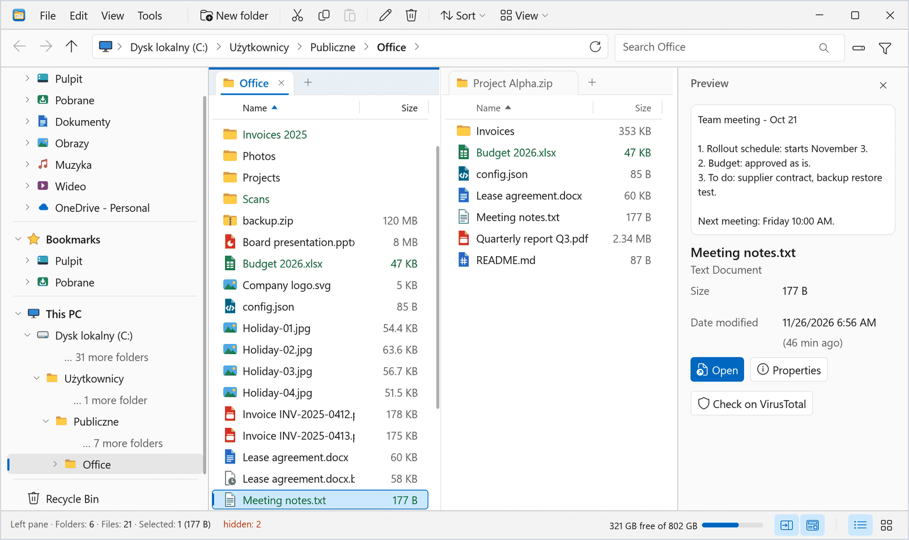
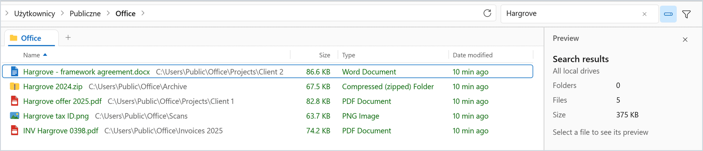
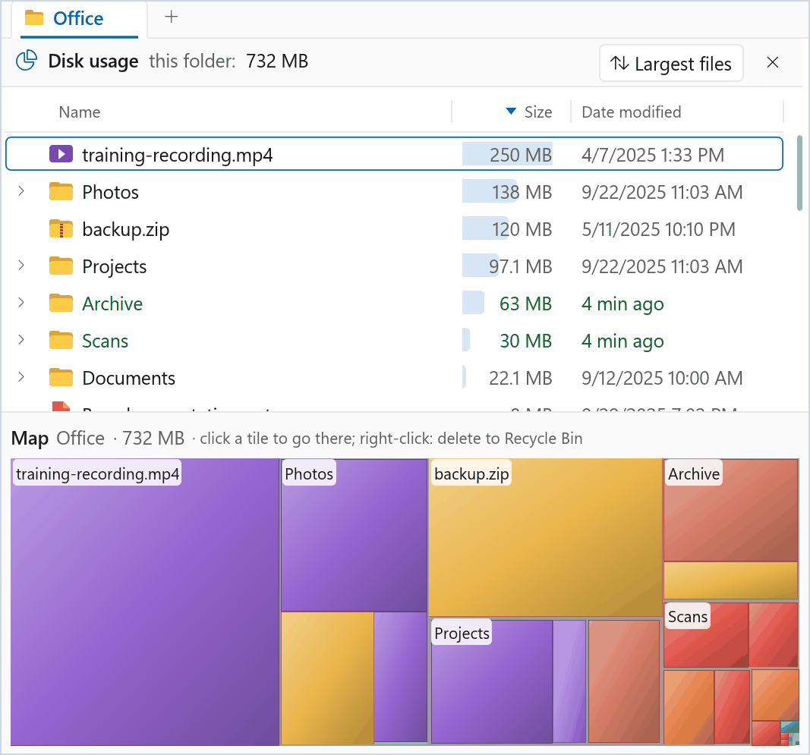
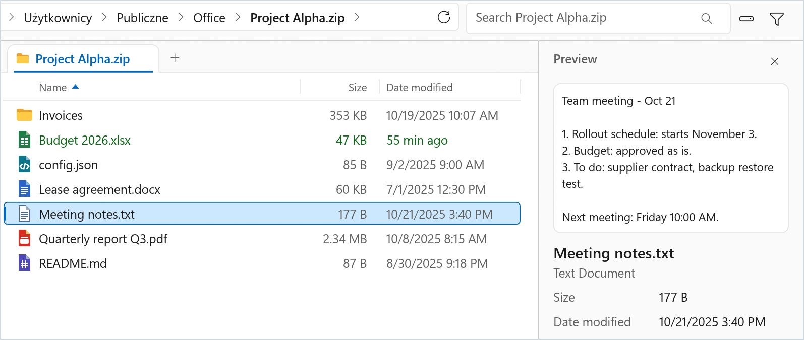
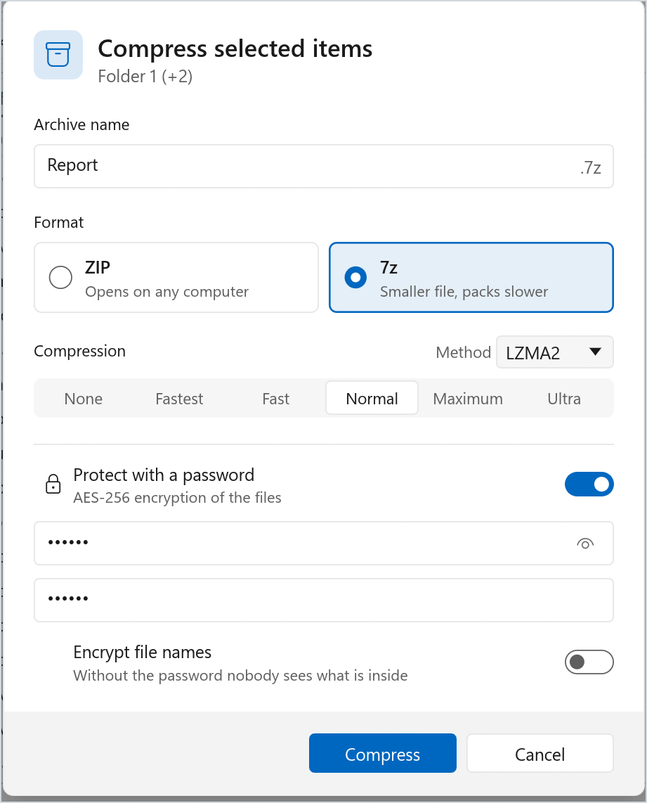
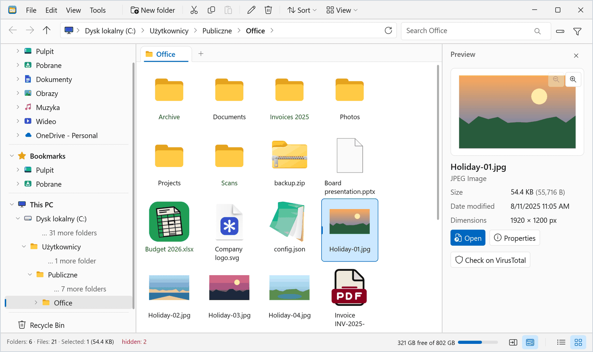
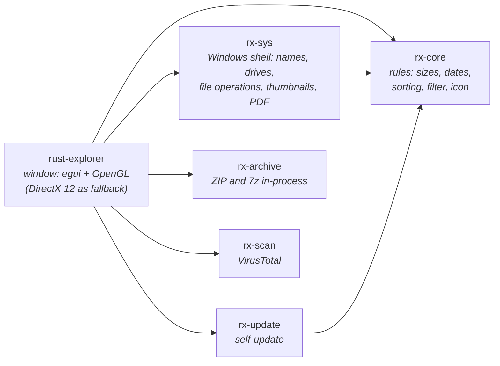

<div align="center">

<b>English</b> | <a href="README.pl.md">Polski</a>


# RustExplorer

**A free file manager for Windows 10 and 11: two panes with tabs, ZIP and 7z you edit like folders,
a file-name search across every local drive in milliseconds, and a map of what fills your disk.**

<a href="https://github.com/jarx-dev/RustExplorer/releases/latest"></a>

<sub>Portable ~19 MB EXE · take `RustExplorer-….exe` under Assets · not code-signed ([first run](#download-and-first-run))</sub>

[](https://github.com/jarx-dev/RustExplorer/releases/latest)
[](https://github.com/jarx-dev/RustExplorer/releases/latest)
[](https://github.com/jarx-dev/RustExplorer/actions/workflows/ci.yml)
[](LICENSE)


<picture>
  <source media="(prefers-color-scheme: dark)" srcset="docs/screenshots/en/hero-dark.png">
  
</picture>

<sub>Left: a folder, files changed in the last 3 hours in green. Right: a ZIP opened as a folder, with a file just added. `F3` splits the window. All screenshots show made-up demo data.</sub>

[Why switch](#why-switch) · [vs File Explorer](#rustexplorer-and-file-explorer) · [Tour](#a-quick-tour) · [Download](#download-and-first-run) · [Privacy](#privacy-at-a-glance) · [For developers](#for-developers)

</div>

## Why switch

- **Two folders side by side in one window.** `F3` splits it into two panes, each with its own tabs;
  drag files from one to the other, or a tab onto the split.
- **5–7 times faster than the Windows shell copy it used before, with thousands of small files.** The program's own copy
  engine works on several files at once: 5,000 files of 20 KB took 1.1–1.6 s on an NVMe SSD, against 8.3 s through the Windows shell
  copy it used before ([measurements](#performance)).
- **Finds a file by name on every local drive at once**: 2–4 ms a query over about 3 million names (files
  and folders) in its own index, which a background scan of about 30 s builds and refreshes ([measurements](#performance)). No Windows Search, no Everything,
  no system service.
- **Shows what fills your disk**: a list by size next to a tile map; a click opens the folder, a right-click
  offers to send it to the Recycle Bin.
- **Archives you can change.** ZIP, 7z and RAR open like folders; preview and open a file without
  extracting the whole archive, and add, delete or rename files inside a ZIP or 7z.
- **See what just changed.** Files and folders created or changed in the last 3 hours show in green,
  with "40 min ago" instead of a date. The status bar in every folder tells you how many files are hidden.
- **Light on your PC.** About 113 MB of private memory with the window open; minimized or in the tray,
  Task Manager shows about 1 MB in use (working set; private memory stays the same). An idle window uses about 0.01 s of CPU per minute.

## RustExplorer and File Explorer

Every statement about File Explorer links to Microsoft's own documentation; a dash means we found
nothing about it there.

| | **RustExplorer** | **File Explorer** (Windows 11) |
|---|---|---|
| **Two folders side by side** | **Yes**: `F3`, each pane with its own tabs | **Tabs and separate windows** (`Ctrl+T`, `Ctrl+N`) ([Microsoft](https://support.microsoft.com/en-us/accessibility/windows/keyboard-shortcuts-in-windows)) |
| **Archives** | **ZIP, 7z, RAR as folders**; ZIP and 7z changed in place; encrypted ones ask for the password when you extract them | **ZIP as a folder**; reads RAR, 7z and TAR, creates ZIP, 7z and TAR (24H2); "does not support operations on encrypted archive files" ([Microsoft](https://support.microsoft.com/en-us/windows/experience/storage-filemanagement/zip-and-unzip-files), [24H2](https://learn.microsoft.com/en-us/windows/whats-new/whats-new-windows-11-version-24h2)) |
| **Name search across drives** | **Own index** of every local drive, loaded when you search | **Windows Search index**: Documents, Pictures, Music and the desktop by default, the whole PC in "Enhanced" mode ([Microsoft](https://support.microsoft.com/en-us/windows/experience/performance-optimization/search-indexing-in-windows)) |
| **What fills the disk** | **Size list and tile map**, for a drive or a folder | **Settings ▸ Storage**, by category such as apps and temporary files ([Microsoft](https://support.microsoft.com/en-us/windows/experience/storage-filemanagement/storage-settings-in-windows)) |
| **Recently changed files** | **Green for 3 hours**, out of the box | — |
| **Undo** | **`Ctrl+Z`**, up to 30 operations | **`Ctrl+Z`**, "undo the previous action" ([Microsoft](https://support.microsoft.com/en-us/accessibility/windows/keyboard-shortcuts-in-windows)) |
| **Price** | **Free**, open source (MIT) | **Part of Windows** |
| **Getting it** | **One ~19 MB EXE**, nothing to install, updates itself | **Built in** |

## A quick tour

### Search everywhere

The drive button next to the search box switches it from the current folder to all local drives. The
program keeps its own index of file names on disk: it loads it when you search (and rescans the drives in
the background if the last scan is over 10 minutes old) and frees it from memory 5 minutes after the last query. Letters with
Polish diacritics match their plain forms (`zolw` finds `żółw`), and every result shows its folder.

<picture>
  <source media="(prefers-color-scheme: dark)" srcset="docs/screenshots/en/find-dark.png">
  
</picture>

### What fills the disk

Tools ▸ "Disk usage" asks for a scope: the whole drive or the current folder. The list is sorted by size and
expands like a tree; the tile map below shows what takes the space. A click on a tile opens that folder (on a file,
shows it in its folder), a right-click offers Open, Copy path and Delete to Recycle Bin, and "Largest files"
lists them together, whatever their folder. The map uses the same index as the search (names and sizes,
rescanned in the background when it is old), not a new scan of the drive.

<picture>
  <source media="(prefers-color-scheme: dark)" srcset="docs/screenshots/en/space-dark.png">
  
</picture>

### Archives as folders

Double-click a ZIP, 7z or RAR file to browse it like a folder, preview the files
and open them without extracting the whole archive. In a ZIP or 7z you also add files (drag or paste),
delete and rename them (a file added to an encrypted ZIP is stored without a password); the program writes the archive anew in the background and replaces the original
only once the new one is complete; save a file opened from a ZIP or 7z in another program within 4 hours and
RustExplorer offers to put it back. RAR is read-only. "Extract here", "Extract to folder" and "Compress…" are in the
right-click menu, all without 7-Zip.

<picture><source media="(prefers-color-scheme: dark)" srcset="docs/screenshots/en/archive-dark.png"></picture>

<sub>Inside a ZIP: a file just added (green) and a preview</sub>

<p align="center"><picture><source media="(prefers-color-scheme: dark)" srcset="docs/screenshots/en/pack-dark.png"></picture><br><sub>Compress… as ZIP or 7z, with a password</sub></p>

### Thumbnails, preview and fresh files

Three views: details, thumbnails, and details with thumbnails. The preview shows pictures, the first page of
a PDF, text and code. Files changed in the last 3 hours stay green in every view; a file you have just copied
counts too, even with an old modification date. The status bar counts hidden files, in red while some are
hidden; a click shows them.

<picture>
  <source media="(prefers-color-scheme: dark)" srcset="docs/screenshots/en/thumbs-dark.png">
  
</picture>

## Everything it does

<details>
<summary><b>The full feature list</b> (18 rows)</summary>

| Feature | What it does |
|---|---|
| 🗂️ **Tabs and split** | Browser-style tabs (`Ctrl+T`, `Ctrl+W`), two panes (`F3`), each with its own tabs; the layout comes back after a restart. |
| 👁️ **Preview** | Images (PNG, JPG, GIF, BMP, WebP, ICO, TIFF), the first page of a PDF, text and code, a folder summary, and a Windows thumbnail for the rest. A cloud-only file is not downloaded for it. |
| 🖼️ **Three views** | Details, thumbnails, details with thumbnails. Columns resize by dragging; in a narrow pane they hide on their own. |
| 🔢 **Natural sorting** | `Report2` before `Report10`. Each folder remembers its own sort order, even after a restart; File ▸ Settings ▸ "Lock format" carries one order on to the next folders. |
| 🔍 **Search and filter** | Search the current folder, or turn the box into a filter such as `*.pdf;*.jpg` or `invoice` that stays with the tab. |
| 📏 **Folder sizes** | One click (or `Space` on selected folders), counted in the background. |
| 🪜 **Flat view** | All files from the subfolders in one list (up to 20,000), with filter and sorting. |
| 🌳 **Path tree** | The tree shows only the path to the current folder; "… N more folders" expands a level. A full tree is in File ▸ Settings. |
| 💽 **This PC and bookmarks** | Drives with a usage bar (red above 90%) and file system; favourite folders in the tree. |
| 📋 **Clipboard and dragging** | Copy and Cut use the Windows clipboard, so files go to and from Explorer, the desktop or a mail program; drop files from other programs onto the list, a folder or a tab. |
| 🪟 **Windows menu** | "Show more options…" (or `Shift`+right-click) opens Explorer's own menu: "Send to", "Open with", 7-Zip, Git, OneDrive. |
| ↩️ **Undo** | `Ctrl+Z` undoes up to 30 operations: delete to the Recycle Bin, move, copy, rename, new folder, `.bak` copy. It never overwrites anything; what cannot be undone, the status bar says. |
| ⏳ **Operations** | One panel for the copying, moving, extracting and VirusTotal checks of all tabs, with speed and a history; the program's own copy and move can also be paused and cancelled. |
| 🧰 **Tools** | A `.bak` copy of a file (`Ctrl+B`, also in the right-click menu), a terminal in the current folder, copy the path. |
| 🛡️ **VirusTotal** | "Check on VirusTotal" in the right-click menu looks a file up by its SHA-256; the file itself leaves your PC only if you choose to upload it. Needs a free API key. |
| 🌙 **Light and dark** | View ▸ Theme: System, Light or Dark; a test keeps text contrast at WCAG 4.5:1 or better in the dark theme. |
| 🔄 **Self-update** | A new release installs itself while you are idle; if it does not start, the previous one comes back. |
| 📌 **Tray** | Closing the window hides it next to the clock; starting the program again brings it back. |

</details>

<details>
<summary><b>Copying, deleting and conflicts in detail</b></summary>

Copying and moving inside the program use its own copy engine, with progress in the Operations panel:
several files at a time (one at a time on a hard disk). When a name is already taken in the target, the
Windows shell takes over with its conflict prompt, as it does for links and folders that need
administrator consent. Files dragged out to other programs or copied with `Ctrl+C` work as in
Explorer. `Delete` sends to the Recycle Bin without asking, as in Windows 11; a file that does not fit
in the Bin (e.g. from a network drive) is deleted permanently, but only after the shell's warning.
Undo restores from the Bin, moves back, sends new copies to the Bin and skips an item that has changed
since; deleting without the Bin, changes inside archives and files replaced during a copy cannot be
undone, and commands from the Windows menu are not undone by the program.

</details>

<details>
<summary><b>Keyboard shortcuts</b></summary>

| Shortcut | Action | Shortcut | Action |
|---|---|---|---|
| `Alt+←` / `Alt+→` | back / forward | `F2` | rename |
| `Backspace`, `Alt+↑` | up one folder | `F3` | split into two panes |
| `Enter` | open | `F5` | refresh |
| `Alt+Enter` | properties | `Delete` | to the Recycle Bin |
| `Ctrl+C` / `X` / `V` | copy / cut / paste | `Ctrl+Z` | undo |
| `Ctrl+A` | select all | `Ctrl+B` | `.bak` copy |
| `Ctrl+T` / `Ctrl+W` | new / close tab | `Ctrl+Shift+N` | new folder |
| `Ctrl+Shift+C` | copy path | `Ctrl` `+` / `−` / `0` | zoom |
| `↑` `↓` `Home` `End` | move through the list (with `Shift`, select) | `PgUp` / `PgDn` | page up / down |
| `Esc` | cancels a rename, clears the search | middle button on a tab | close the tab (not a pinned one) |
| `Space` | size of the selected folders (in the Size column) | | |

</details>

## What it does not do

- **Windows only**: Windows 10 and 11 on x64. No ARM build, no macOS or Linux.
- **No batch renaming, folder comparison or synchronisation, tags, FTP or plugins.**
- **RAR is read-only**: browse and extract, no changes inside. An encrypted 7z or an old-style ZipCrypto ZIP
  can be extracted but not changed.
- **Two languages**: English and Polish.
- **Not code-signed**, so Windows may warn on the first start (see below).
- **Paths longer than 260 characters** work for listing, renaming and the program's own copy, but deleting
  through the Windows shell, opening, properties and thumbnails may still fail on them.

## Download and first run

<a href="https://github.com/jarx-dev/RustExplorer/releases/latest"></a>

1. **Download** `RustExplorer-….exe` from the **Assets** list on the
   [release page](https://github.com/jarx-dev/RustExplorer/releases/latest) (the button opens that page).
2. **Run it.** There is nothing to install. Windows SmartScreen may warn about an unknown publisher:
   "More info" → "Run anyway".

Optional: every GitHub release is built by GitHub Actions from this repository with a provenance
attestation, which the [GitHub CLI](https://cli.github.com/) checks:

```powershell
gh attestation verify RustExplorer-<version>.exe -R jarx-dev/RustExplorer
```

Settings and tabs are kept in `%APPDATA%\RustExplorer`. New releases are downloaded by the program
itself, checked against their size and SHA-256, and rolled back if the new version does not start.

Something does not work, or you miss a feature? [Open an issue](https://github.com/jarx-dev/RustExplorer/issues).

## Performance

Measured on a laptop with an AMD Ryzen 7 8840HS, integrated Radeon 780M graphics and one NVMe SSD (so the copy
went from and to the same drive, and the search covers that single drive).

| What | Result |
|---|---|
| Copying 5,000 files of 20 KB | **1.1–1.6 s** (8.3 s through the Windows shell copy it used before) |
| Name search over 2.97 million files on drive C: | **2–4 ms** a query (12 ms for a single letter); the index loads in 0.2 s, takes 215 MB on disk and a full scan 31 s |
| Memory, window open, a folder of 3,000 files | **~113 MB** private memory |
| Memory, minimized or in the tray | **~1 MB** working set |
| CPU, idle window | ~0.01 s per minute |
| Program | one EXE, 18.8 MB (release v26.1122.0933) |

On an integrated GPU, graphics memory is ordinary process RAM, so most of the 113 MB is the graphics
driver: an empty egui window alone takes almost as much. Details in [Under the hood](#under-the-hood).

## Privacy at a glance

No analytics and no tracking. The program sends no file names, paths or contents anywhere on its own; a
file goes to VirusTotal only if you choose to upload it. Apart from network folders you open yourself, a release from GitHub, with default settings, connects only to:

- **GitHub** (github.com and the host it serves release files from), to check for a new release (every minute, every 15 minutes while minimized or in the tray)
  and download it. A plain `cargo build` never checks.
- **errors.jarx.pl**, to send one short crash report after the program panics (an internal error); on by default, File ▸ Settings switches it off
  ([exactly what it contains](#crash-reports)).
- **VirusTotal**, only when you click "Check on VirusTotal", with your own API key: it sends the file's
  SHA-256, and the file only if you choose to upload it.

Links in File ▸ "About" open in your browser when you click them.

Kept on your PC: settings, tabs and VirusTotal results (path and SHA-256 of each checked file) in
`%APPDATA%\RustExplorer`; the VirusTotal API key in Windows Credential Manager; the index of file names
(about 215 MB for 3 million files) in `%LOCALAPPDATA%\RustExplorer`; copies of files opened from archives
in `%TEMP%`, removed at a later start once unused for a day.

## Crash reports

After the first panic of a run (a Rust bug: usually the program then crashes, sometimes it
recovers and goes on), it sends one short report, with no user or installation id, so the bug can be
found and fixed. It is on by default; switch it off in **File → Settings → Send crash reports**
(Polish UI: **Plik → Ustawienia → Wysyłaj raporty o awariach**). The change applies at once and is saved
right away.

The whole report, three lines:

```
{"event_id":"5f1c0a9e2b7d4c3e8a6f1b2d3c4e5f60"}
{"type":"event"}
{"event_id":"5f1c0a9e2b7d4c3e8a6f1b2d3c4e5f60","level":"fatal","platform":"native","release":"rustexplorer@26.1104.2135","environment":"production","contexts":{"os":{"name":"Windows","version":"10.0.26100"}},"exception":{"values":[{"type":"panic","value":"src/main.rs:1234","mechanism":{"type":"panic","handled":false}}]},"fingerprint":["src/main.rs:1234"]}
```

That is: the program's build number (its build time in UTC, `YY.MMDD.HHMM`), the Windows version
(with its build number) and the place in the program's source code where the panic happened
(`file:line`). A path inside the program's repository stays as it is; a library from the cargo
registry keeps the part from its crate folder (`ureq-2.12.1/src/pool.rs`); the standard library
the part from `library/` (`core/src/option.rs`); any other path becomes the file name alone. `event_id` is random, new for every report. The
request also has the `User-Agent` and `X-Sentry-Auth` headers with the program's name and version
and the project's public key, nothing more.

Never sent: the panic message (it can contain a file name or text), names or paths of your files,
the computer name, your user name, e-mail addresses, any content, settings, logs, environment
variables, an installation or user id, session data. At most one report per run; only release
builds send (also your own `cargo build --release`), a debug build and screenshot runs never do.
The program waits at most 3 s for the server, and any error is ignored.

Where it goes: the author's own [Rustrak](https://github.com/rustrak/rustrak) server (open source,
Sentry-compatible) at `errors.jarx.pl`. The report is stored only there, on no other company's
service. On the way the traffic passes through Cloudflare, like that of any site behind Cloudflare.
The report holds no IP address, but the server, like every web server, sees the connection's IP in
its access log.

The code that builds and sends the report is one short file you can check:
[`crates/rx-update/src/crash_report.rs`](crates/rx-update/src/crash_report.rs).

## For developers

### Under the hood

<details>
<summary><b>Crates, threads, updates, the window</b></summary>



- **`rx-core`** knows nothing about the window or the Windows API, so its tests run on any system
  (`cargo test -p rx-core`). Natural sorting compares names in place, without allocating memory on
  each comparison; a test makes sure the result is identical to that of the first, simpler version.
- **`rx-sys`** is a thin layer over `windows-rs`: `SHFileOperation`, `IShellItemImageFactory`
  for thumbnails, `Windows.Data.Pdf` for the PDF preview. The `watch` module follows the folders
  visible on screen without holding a handle on them (so other programs can rename parent
  folders): on fixed drives that cannot be removed, one thread reads the changes of the whole
  volume (`ReadDirectoryChangesW` on its root directory) and picks those that concern the folders
  shown; on the rest (network, removable, external, virtual) a second thread compares the listing
  every 10 s. The window does not poll the disk and does not wake up by itself when idle; a folder
  that is written to continuously refreshes at most once per second.
- **The window does not wait for the disk when listing.** The folder listing (archives too), the
  folders in the tree, and the drives with their names and free space are read by separate
  threads; the result comes back as a message carrying a request number, and only the reply to the
  latest request counts (`rx_core::Asked`), so a late listing of a folder we have already left
  overwrites nothing. Until the listing arrives, the tab shows the previous rows or "Loading…",
  and selecting the new folder, a file after a rename, or the folder we came up from
  waits for it as a saved intent (`rx_core::Select`). Tabs from the previous session open without
  asking the disk, so an unavailable network drive does not hold up startup: its tab shows an error
  in the list once the system stops waiting for it. The preview is built by a separate thread (of a
  series of selections only the last one), and a file that exists only in the cloud is not read for it.
- **Archives** are read and written in-process by `rx-archive` (ZIP, 7z; RAR read-only), without
  7-Zip and without `tar.exe`. A changed archive is written to a new file first, and the original is
  replaced only once that has succeeded.
- **Copying** (`rx_core::copy`, `CopyFileExW`) plans the whole tree first, then copies 4 files at a
  time (1 on a hard disk), with progress in bytes. A move within a volume is a rename; between drives
  the source goes only after everything was copied, and only what was copied.
- **Thumbnails**: at most 500 textures; past that, the least recently drawn ones disappear. A thread
  loads them in the order they were requested and skips tiles that have already left the screen. A
  folder of 3000 files scrolled to the end in Thumbnails uses 141 MB of private memory (364 MB before
  the limit), and a folder of 12,000 files levels off at about 185 MB.
- **Clipboard, dragging and the Windows menu** (`rx-sys`: the `clip` and `menu` modules): Copy and
  Cut put the same data object on the clipboard as Explorer does (`CF_HDROP` with "Preferred
  DropEffect", `OleSetClipboard`, which survives closing the program), and dragging out hands it to
  `SHDoDragDrop`; the target decides about a move, and the program deletes nothing itself. The
  Windows menu is the shell's `IContextMenu` shown at the cursor; the menu items are read by a
  background thread, so a network drive that does not respond does not freeze the window.
- **`rx-update`** checks the `latest.json` file every minute, or every 15 minutes while the window is
  minimized or in the tray, downloads a newer build, verifies its size, SHA-256 and EXE header, and
  replaces the program only when the window is minimized, hidden or unused and nothing is working:
  neither the program's own copying nor a thread the shell started inside the process for a Windows
  menu command (e.g. "Send to" on a USB stick; the program gives the shell a reference to the
  process through `SHSetInstanceExplorer` and sees that it is being held).
  The old version stays on as a "guard": if the new one does not draw its window within 3 minutes,
  the previous one comes back, and a failed build is not installed a second time. Plain HTTP is
  allowed only for Tailscale addresses (`100.64.0.0/10`, `fd7a:115c:a1e0::/48`, `*.ts.net`) and
  localhost, and HTTPS everywhere else; redirects only from HTTPS to HTTPS (which is how GitHub
  releases work).
- **The icon** is drawn in code (`crates/rx-core/src/icon.rs`, distance functions from rounded
  rectangles): it produces the window and tray icons, and `rust-explorer.exe --save-icon ikona.ico`
  writes it to a file that `build.rs` embeds in the EXE (MSVC build).
- **Manifest** (`rustexplorer.manifest`, embedded by `build.rs` together with the icon): `asInvoker`
  (no administrator rights), Windows 10/11 compatibility and `longPathAware` (when `LongPathsEnabled`
  is turned on in Windows). This entry lifts the 260-character limit only for direct Win32 calls
  (undoing a rename, "Always keep on this device", the folder
  watcher); listing, new folder and rename go through `std::fs`, which gets around the limit even
  without the manifest. The program's own copy and move add the `\\?\` prefix to long paths
  themselves. Deleting, copying and moving through the shell (`SHFileOperationW`), opening, properties, the
  Windows menu and thumbnails are shell calls that this entry does not cover: with paths over 260
  characters they may still fail (untested). No DPI, controls or theme entries, so the look does
  not change; no segment heap: 1–2 MB less private memory out of about 112 MB, and CPU with
  thumbnails no better (10.2–10.7 s versus 9.2–10.1 s, two runs each).
- **The title bar** is drawn by the program, but hovering over "Maximize" shows the system's
  snap layouts menu: a window subclass (`rx-sys/src/caption.rs`) answers Windows with
  `HTMAXBUTTON` over the rectangle of that button. The minimum window size is 420×320 pt
  (`MIN_SIZE`): the icon, four menus and window buttons still fit, and Microsoft asks for a minimum
  width of at most 500 ([snap layouts](https://learn.microsoft.com/en-us/windows/apps/desktop/modernize/ui/apply-snap-layout-menu)),
  so the window also fills narrow snap zones. In a narrow window, the toolbar buttons disappear
  first, then the tree (below 480 pt), the preview (below 700 pt), the search box and the free space
  on the status bar.
- **Screenshot mode** (`--screenshot <file.png>`) is meant for tests: a separate, throw-away layout,
  with no tray and no updates, and the window is cloaked by DWM (it draws normally but does not
  appear on screen, takes no focus and has no taskbar button), so tests can run on a computer that is
  in use; `--visible` shows it.

</details>

### Size and memory

<details>
<summary><b>How the EXE got to its size, and where the memory goes</b></summary>

| | EXE |
|---|---|
| start (default eframe/wgpu features) | 18.1 MB |
| + LTO, `codegen-units = 1`, `strip` | 15.6 MB |
| + only DirectX 12 in wgpu (no Vulkan, GL or Metal) | 13.8 MB |
| + tray icon | 14.1 MB |
| + OpenGL as the main renderer | 14.4 MB |
| today's release (archives, VirusTotal, index, clipboard, Windows menu…) | 18.8 MB |

Measured on a laptop with a Ryzen and integrated Radeon 780M graphics (a folder of 3000 files, a
1600×860 window at 175% scale). On an integrated GPU, GPU memory is ordinary process RAM.

| | working set | private memory |
|---|---|---|
| DirectX 12, default wgpu settings | 430–460 MB | 430–455 MB |
| DirectX 12, `MemoryHints::MemoryUsage` | ~280 MB | ~280 MB |
| **OpenGL** (default), Details, idle window | **~109 MB** | **~113 MB** |
| OpenGL, Thumbnails scrolled to the end of the folder | ~136 MB | ~141 MB |
| window minimized or hidden to the tray, after 3 s | **~1 MB** | unchanged |

Most of what remains is the graphics driver: an empty egui window alone takes almost as much.
An idle window does nothing: in 80 s it draws about 122 frames (almost all of them at startup) and
uses about 0.01 s of CPU per minute.
A minimized window draws nothing, so the program then hands its pages back to the system
(`SetProcessWorkingSetSize`) and Task Manager shows about 1 MB; they return from the cache on first
use. A window that is merely covered by another one keeps drawing and stays at ~120 MB.
Along with handing back memory, the process switches to the Windows 11 efficiency mode (EcoQoS) and
leaves it when the window is shown; copying, compressing or an index scan running in the background
hold it off. A re-scan of the index that nobody is waiting for runs at Windows background priority.

The program uses OpenGL. If the OpenGL driver fails to start, it switches to DirectX 12.

</details>

### Building

On Windows:

```powershell
cargo build --release
# target\release\rust-explorer.exe
```

On Linux (cross-compiling, without Windows), via [cargo-xwin](https://github.com/rust-cross/cargo-xwin):

```bash
cargo install cargo-xwin
cargo xwin build --release --target x86_64-pc-windows-msvc
cargo test -p rx-core -p rx-update -p rx-archive -p rx-scan    # tests without Windows
```

The Rust version is pinned in `rust-toolchain.toml`.

Releases on GitHub are built by GitHub Actions (the release workflow, `.github/workflows/release.yml`, named "Wydanie", Polish for "Release", and started manually from `main`):
the EXE, `latest.json` for updates and a build provenance attestation for the file. Every PR and every
change to `main` goes through a build and tests on Windows (the "CI" workflow).

### Your own update server

<details>
<summary><b>Publish your own builds to your own server</b></summary>

A plain build never updates itself. Only a build from a GitHub release (it fetches later releases)
or from `scripts/publish.sh` does, which embeds the `latest.json` address and the version identity.
The script needs `cargo-xwin` and `jq`:

```bash
mkdir -p ~/updates && (cd ~/updates && python3 -m http.server 8790 --bind <tailscale-address>) &
RUSTEXPLORER_UPDATE_BASE=http://<tailscale-address>:8790/rustexplorer \
RUSTEXPLORER_UPDATE_DIR=~/updates/rustexplorer \
scripts/publish.sh
```

`RUSTEXPLORER_UPDATE_DIR` is the directory with the builds, and `RUSTEXPLORER_UPDATE_BASE` is the
address at which that directory is visible (the server runs in the parent directory). The address
is required; both variables can be kept outside the repository in
`~/.config/rustexplorer/build.env`. Instead of `http.server` you can use any file server on the
Tailscale network, or HTTPS.

The same variables passed to `scripts/auto-publish.sh --install` go into a systemd timer that
builds and publishes every new commit on `main` every minute. On the computer running the program,
`RUSTEXPLORER_UPDATE_URL=off` turns updates off, and a different `latest.json` address in that variable
points them elsewhere. The update progress is logged in `%APPDATA%\RustExplorer\update.log`.

</details>

## About the author

RustExplorer was written by **Jarosław Hartwich** ([github.com/jarx-dev](https://github.com/jarx-dev)).
You can find the same in the program: File → "About".

If RustExplorer is useful to you, you can [buy me a coffee](https://buymeacoffee.com/jarx) ☕

## License

[MIT](LICENSE). The `patches/windows-link` directory is a patch of the
[windows-link](https://crates.io/crates/windows-link) crate (MIT/Apache-2.0) for the GNU build.
