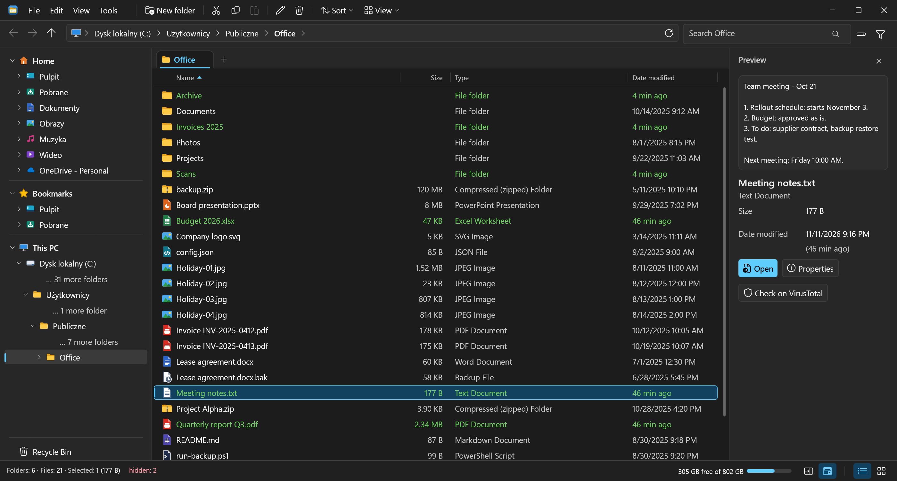
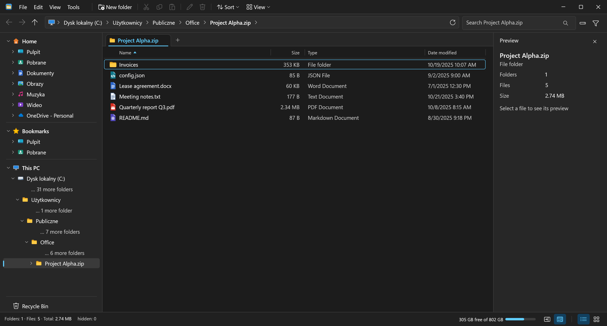
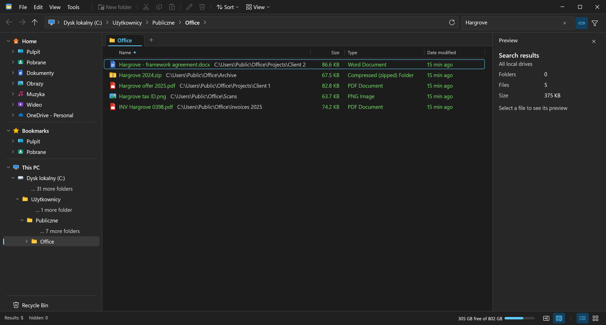
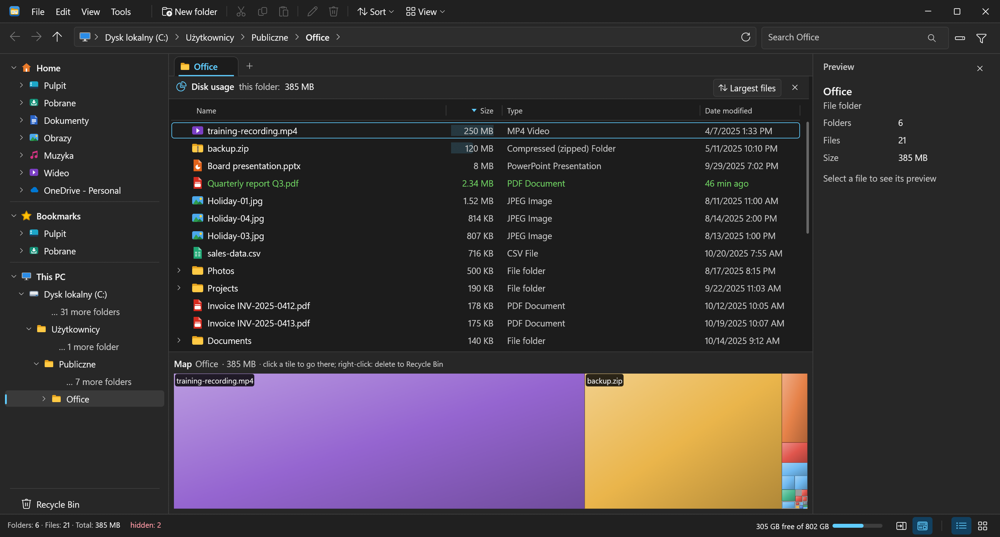
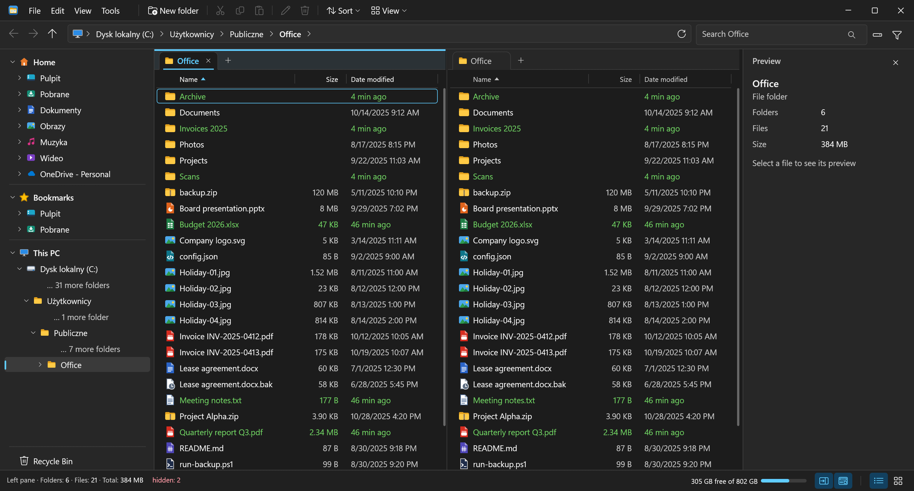
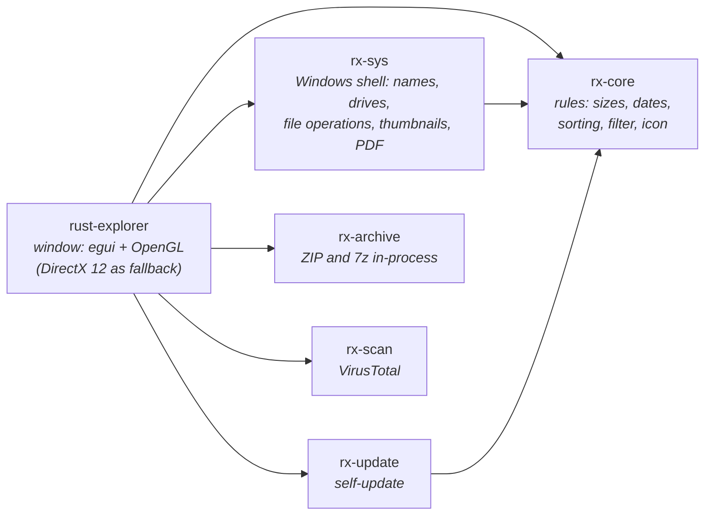

<p align="center">
  <b>English</b> | <a href="README.pl.md">Polski</a>
</p>

<p align="center">
  
</p>

<h1 align="center">RustExplorer</h1>

<p align="center">
  <b>A fast, dual-pane file manager for Windows 11, written in Rust.</b><br>
  A single <code>.exe</code> (~18 MB): no installer, no .NET, no Electron.
</p>

<p align="center">
  <b><a href="https://github.com/jarx-dev/RustExplorer/releases/latest">Download the latest version</a></b>
</p>

<p align="center">
  
  <br><sub>All screenshots show a folder of demo data (made-up files).</sub>
</p>

> **Note:** the interface is in English by default; Polish is one click away in File ▸ Settings ▸ Language / Język. Labels below are quoted as the English interface shows them.

---

## Why?

Windows Explorer is convenient until you need to compare two folders, find a file deep in a
tree, or see what is eating your disk space. Classic dual-pane file managers can do all of that,
but they look like they are from 2005 or cost money. RustExplorer sits in between: it looks and
behaves like Windows 11, and underneath it has what Explorer lacks.

## Highlights

### Archives as folders

You open ZIP, 7z and RAR files with a double-click, like any folder: browse them, preview files and
open them without extracting the whole archive. ZIP and 7z can also be modified in place: you add
files by dragging or pasting, delete them and rename them, and the program rewrites the archive in
the background. When you save a file opened from an archive in another program, RustExplorer asks
whether to update it in the archive. RAR is read-only and extract-only. "Extract here",
"Extract to folder" and "Compress…" (as ZIP or 7z) are in the right-click
menu; an encrypted archive asks for its password. Everything runs inside the program itself
(the `rx-archive` crate), without 7-Zip and without `tar.exe`, and progress shows in the "Operations"
panel.



### Search everywhere

The disk button next to the search box switches it from the current folder to all local drives, as in
Everything, but without Everything and without an administrator service. The program keeps its own
index of file names on disk: it loads the index only on the first search, refreshes it in the background
at most every 10 minutes and frees it from memory 5 minutes after the last query. On a drive with
3 million files a query takes a few milliseconds, Polish diacritics do not matter (`zolw` finds `żółw`),
and each result shows its folder.



### Disk space analysis

Tools ▸ "Disk usage" asks for a scope: the whole drive or the current folder. The list is
sorted by size and expands like a tree, and below it a tile map shows what takes up the space.
Clicking a tile jumps to that folder, right-clicking sends it to the Recycle Bin, and "Largest files"
lists them together, regardless of folder. The map uses the drive index, so the whole
drive is not scanned again.



### A tree without clutter

The tree on the left shows only the path to the current folder. The rest of each level is collapsed
into "… N more folders" and expands with a click, so even in a deep folder the tree fits
on the screen. You can turn on the full tree in File ▸ Settings ▸ Full folder tree.

### Two panes

`F3` splits the window into two panes, each with its own tabs, filter and search. You drag files
between the panes, or tabs onto the split.



### Fresh files in green

Files and folders created or modified in the last 3 hours have green text across the whole row, and
show "40 min ago" instead of a date. A fresh creation counts too, so a file you just copied
shows up green even though its modification date is old. You can see this in the screenshots
above: three files changed a moment ago and folders that just received something. You don't need to
sort by date to see what has just changed.

### Sorting remembered per folder

Each folder remembers its own sort order: sort "Downloads" newest first and "Invoices" by
name, and each opens the way you left it, even after a restart. A folder sorted the plain way
(Name ascending) remembers nothing. If you want to carry one sort order over to subsequent folders,
File ▸ Settings ▸ "Lock format (keep sorting)" keeps it while you
navigate; the badge on the status bar turns the lock off.

## What it can do

| | |
|---|---|
| 🗂️ **Tabs and split** | Browser-style tabs (`Ctrl+T`, `Ctrl+W`), a split view with two panes (`F3`), each with its own tabs. The layout comes back after a restart. |
| 👁️ **Preview** | Images (PNG, JPG, GIF, BMP, WebP, ICO, TIFF), the first page of a PDF, text and code files, a folder summary, and for everything else a thumbnail from the Windows shell. A file that exists only in the cloud is not downloaded for the preview: you see its thumbnail and a "Download to preview" button. |
| 🖼️ **Three views** | Details, thumbnails, and details with thumbnails. You resize each column by dragging its border in the header (a double-click on the Name border restores fill mode); in a narrow pane the columns hide on their own. |
| 🔢 **Natural sorting** | `Report2` before `Report10`, case-insensitive; each folder remembers its own sort order. |
| 🔍 **Search and filter** | A search box for the current folder; the funnel next to it turns it into a filter such as `*.pdf;*.jpg` or simply `invoice` (matches anywhere in the name), which applies only to the current tab (in the two-pane view each pane has its own) and stays when you change folder. |
| 🟩 **What's new?** | Files created or modified in the last 3 hours have green text and "N min ago" instead of a date. |
| 🌙 **Dark theme** | View ▸ Theme: System (follows the Windows setting, including changes made while running), Light or Dark. The colours of both themes are in `crates/rx-core/src/palette.rs`, and a test checks text contrast (WCAG, at least 4.5:1 in the dark theme). |
| 📏 **Folder sizes** | One click, in the background, without blocking the window. |
| 🪜 **Flat view** | All files from subfolders in a single list (up to 20,000), with filtering and sorting. |
| 💽 **This PC** | Drives with a usage bar (red above 90%), file system, network drives. |
| ⭐ **Bookmarks** | Favourite folders in the tree on the left, next to quick access. |
| 🌳 **Path tree** | The tree on the left shows only the path to the current folder; "… N more folders" expands that level, and File ▸ Settings ▸ Full folder tree shows them all. |
| 🧰 **Tools** | A `.bak` copy with one shortcut (`Ctrl+B`), ZIP extraction, a terminal in the current folder, copying the path (from a Samba network drive as a Linux path `/home/<user>/…`), "Lock format (keep sorting)". |
| 📋 **Clipboard and dragging** | Copy and Cut put files on the Windows clipboard (like Explorer), so you can paste them in Explorer, on the desktop or in a mail client, and files copied there can be pasted here; archive items stay in the program's own clipboard. You drop files from other programs onto the list or onto a folder (copy; with `Shift`, move), and a row dragged outside the window carries on as an ordinary Windows drag. |
| 🪟 **Windows menu** | "Show more options…" at the end of the right-click menu (or `Shift`+right-click) shows Explorer's own menu for the selection: "Send to", "Open with", 7-Zip, Git, "Free up space" and "Always keep on this device" in OneDrive. |
| ↩️ **Undo** | `Ctrl+Z` undoes the most recent operations (up to 30): deleting to the Recycle Bin (restores from the Bin), a move (moves back), a copy (the copies go to the Bin, newly created ones only), a rename, a new folder and a `.bak` copy; it never overwrites anything and skips an item that has changed since. What cannot be undone (deleting from disk without the Bin, changes inside archives, files replaced during a copy) is reported by the status bar; commands from the Windows menu are not undone by the program. |
| 🔄 **Self-update** | A new version installs itself when you are idle; if it fails to start, the previous one comes back. Details below. |
| 📌 **Tray** | An icon next to the clock; clicking it shows or hides the window. Closing the window hides it to the tray (no taskbar button), and starting the program again restores it; "Exit" exits the program. |

Copying, moving and deleting go through the Windows shell, so you get the same progress windows and
conflict prompts as in Explorer. `Delete` sends to the Recycle Bin without asking, as in Windows 11;
a file that does not fit in the Bin (e.g. from a network drive) is deleted permanently, but only
after the shell's warning.

### Shortcuts

| Shortcut | Action | Shortcut | Action |
|---|---|---|---|
| `Alt+←` / `Alt+→` | back / forward | `F2` | rename |
| `Backspace`, `Alt+↑` | up one folder | `F3` | split into two panes |
| `Enter` | open | `F5` | refresh |
| `Alt+Enter` | properties | `Delete` | to the Recycle Bin |
| `Ctrl+C` / `X` / `V` | copy / cut / paste | `Ctrl+Z` | undo |
| `Ctrl+A` | select all | `Ctrl+B` | `.bak` copy |
| `Ctrl+T` / `Ctrl+W` | new / close tab | `Ctrl+Shift+N` | new folder |
| `Ctrl+Shift+C` | copy path | `Ctrl` `+` / `−` / `0` | zoom |
| `↑` `↓` `Home` `End` | move through the list (with `Shift`, select) | `PgUp` / `PgDn` | page up / down |
| `Esc` | cancels a rename, clears the search | middle button on a tab | close the tab |
| `Space` | size of the selected folders (in the Size column) | | |

## Under the hood



- **`rx-core`** knows nothing about the window or the Windows API, so its tests run on any system
  (`cargo test -p rx-core`). Natural sorting compares names in place, without allocating memory on
  each comparison; a test makes sure the result is identical to that of the first, simpler version.
- **`rx-sys`** is a thin layer over `windows-rs`: `SHFileOperation`, `IShellItemImageFactory`
  for thumbnails, `Windows.Data.Pdf` for the PDF preview. The `watch` module follows the folders
  visible on screen without holding a handle on them (so other programs can rename parent
  folders): on fixed drives that cannot be removed, one thread reads the changes of the whole
  volume (`ReadDirectoryChangesW` on its root directory) and picks those that concern the folders
  shown; on the rest (network, removable, external, virtual) a second thread compares the listing
  every 10 s. The window does not poll the disk and does not wake up by itself when idle; a folder
  that is written to continuously refreshes at most once per second.
- **The window does not wait for the disk when listing.** The folder listing (archives too), the
  folders in the tree, and the drives with their names and free space are read by separate
  threads; the result comes back as a message carrying a request number, and only the reply to the
  latest request counts (`rx_core::Asked`), so a late listing of a folder we have already left
  overwrites nothing. Until the listing arrives, the tab shows the previous rows or "Loading…",
  and selecting the new folder, a file after a rename, or the folder we came up from
  waits for it as a saved intent (`rx_core::Select`). Tabs from the previous session open without
  asking the disk, so an unavailable network drive does not hold up startup: its tab shows an error
  in the list once the system stops waiting for it. The preview is built by a separate thread (of a
  series of selections only the last one), and a file that exists only in the cloud is not read for it.
- **Thumbnails**: at most 500 textures; past that, the least recently drawn ones disappear. A thread
  loads them in the order they were requested and skips tiles that have already left the screen. A
  folder of 3000 files scrolled to the end in Thumbnails uses 141 MB of private memory (364 MB before
  the limit), and a folder of 12,000 files levels off at about 185 MB.
- **Clipboard, dragging and the Windows menu** (`rx-sys`: the `clip` and `menu` modules): Copy and
  Cut put the same data object on the clipboard as Explorer does (`CF_HDROP` with "Preferred
  DropEffect", `OleSetClipboard`, which survives closing the program), and dragging out hands it to
  `SHDoDragDrop`; the target decides about a move, and the program deletes nothing itself. The
  Windows menu is the shell's `IContextMenu` shown at the cursor; the menu items are read by a
  background thread, so a network drive that does not respond does not freeze the window.
- **`rx-update`** checks the `latest.json` file every minute, or every 15 minutes while the window is
  minimized or in the tray, downloads a newer build, verifies its size, SHA-256 and EXE header, and
  replaces the program only when the window is minimized, hidden or unused and nothing is working:
  neither the program's own copying nor a thread the shell started inside the process for a Windows
  menu command (e.g. "Send to" on a USB stick; the program gives the shell a reference to the
  process through `SHSetInstanceExplorer` and sees that it is being held).
  The old version stays on as a "guard": if the new one does not draw its window within 3 minutes,
  the previous one comes back, and a failed build is not installed a second time. Plain HTTP is
  allowed only for Tailscale addresses (`100.64.0.0/10`, `fd7a:115c:a1e0::/48`, `*.ts.net`) and
  localhost, and HTTPS everywhere else; redirects only from HTTPS to HTTPS (which is how GitHub
  releases work).
- **The icon** is drawn in code (`crates/rx-core/src/icon.rs`, distance functions from rounded
  rectangles): it produces the window and tray icons, and `rust-explorer.exe --save-icon ikona.ico`
  writes it to a file that `build.rs` embeds in the EXE (MSVC build).
- **Manifest** (`rustexplorer.manifest`, embedded by `build.rs` together with the icon): `asInvoker`
  (no administrator rights), Windows 10/11 compatibility and `longPathAware` (when `LongPathsEnabled`
  is turned on in Windows). This entry lifts the 260-character limit only for direct Win32 calls
  (undoing a rename, "Always keep on this device", the folder
  watcher); listing, new folder and rename go through `std::fs`, which gets around the limit even
  without the manifest. Deleting, copying and moving (`SHFileOperationW`), opening, properties, the
  Windows menu and thumbnails are shell calls that this entry does not cover: with paths over 260
  characters they may still fail (untested). No DPI, controls or theme entries, so the look does
  not change; no segment heap: 1-2 MB less private memory out of about 112 MB, and CPU with
  thumbnails no better (10.2-10.7 s versus 9.2-10.1 s, two runs each).
- **The title bar** is drawn by the program, but hovering over "Maximize" shows the system's
  snap layouts menu: a window subclass (`rx-sys/src/caption.rs`) answers Windows with
  `HTMAXBUTTON` over the rectangle of that button. The minimum window size is 420×320 pt
  (`MIN_SIZE`): the icon, four menus and window buttons still fit, and Microsoft requires at most 500,
  so the window also fills narrow snap zones. In a narrow window, the toolbar buttons disappear
  first, then the tree (below 480 pt), the preview (below 700 pt), the search box and the free space
  on the status bar.
- **Screenshot mode** (`--screenshot <file.png>`) is meant for tests: a separate, throw-away layout,
  with no tray and no updates, and the window is cloaked by DWM (it draws normally but does not
  appear on screen, takes no focus and has no taskbar button), so tests can run on a computer that is
  in use; `--visible` shows it.

### Size

| | EXE |
|---|---|
| start (default eframe/wgpu features) | 18.1 MB |
| + LTO, `codegen-units = 1`, `strip` | 15.6 MB |
| + only DirectX 12 in wgpu (no Vulkan, GL or Metal) | 13.8 MB |
| + tray icon | 14.1 MB |
| + OpenGL as the main renderer | 14.4 MB |
| today's build (archives, VirusTotal, index, clipboard, Windows menu…) | 17.9 MB |

### Memory

Measured on a laptop with a Ryzen and integrated Radeon 780M graphics (a folder of 3000 files, a
1600×860 window at 175% scale). On an integrated GPU, GPU memory is ordinary process RAM.

| | working set | private memory |
|---|---|---|
| DirectX 12, default wgpu settings | 430-460 MB | 430-455 MB |
| DirectX 12, `MemoryHints::MemoryUsage` | ~280 MB | ~280 MB |
| **OpenGL** (default), Details, idle window | **~109 MB** | **~113 MB** |
| OpenGL, Thumbnails scrolled to the end of the folder | ~136 MB | ~141 MB |
| window minimized or hidden to the tray, after 3 s | **~1 MB** | unchanged |

Most of what remains is the graphics driver: an empty egui window alone takes almost as much.
An idle window does nothing: in 80 s it draws about 122 frames (almost all of them at startup) and
uses about 0.01 s of CPU per minute.
A minimized window draws nothing, so the program then hands its pages back to the system
(`SetProcessWorkingSetSize`) and Task Manager shows about 1 MB; they return from the cache on first
use. A window that is merely covered by another one keeps drawing and stays at ~120 MB.
Along with handing back memory, the process switches to the Windows 11 efficiency mode (EcoQoS) and
leaves it when the window is shown; copying, compressing or an index scan running in the background
hold it off. A re-scan of the index that nobody is waiting for runs at Windows background priority.

The program uses OpenGL. If the OpenGL driver fails to start, it switches to DirectX 12.

## Download

The ready-made EXE is in the [releases](https://github.com/jarx-dev/RustExplorer/releases/latest). Just
download and run it, no installation (Windows 10 or 11). The program fetches later releases by itself.
The file is not signed, so the first time Windows may warn about an unknown publisher:
"More info" → "Run anyway".

## Building

On Windows:

```powershell
cargo build --release
# target\release\rust-explorer.exe
```

On Linux (cross-compiling, without Windows), via [cargo-xwin](https://github.com/rust-cross/cargo-xwin):

```bash
cargo install cargo-xwin
cargo xwin build --release --target x86_64-pc-windows-msvc
cargo test -p rx-core -p rx-update -p rx-archive      # tests without Windows
```

The Rust version is pinned in `rust-toolchain.toml`.

Releases on GitHub are built by GitHub Actions (the "Wydanie" (Release) workflow, started manually from `main`):
the EXE, `latest.json` for updates and a build provenance attestation for the file. Every PR and every
change to `main` goes through a build and tests on Windows (the "CI" workflow).

### Your own update server

A plain build never updates itself. Only a build from a GitHub release (it fetches later releases)
or from `scripts/publish.sh` does, which embeds the `latest.json` address and the version identity.
The script needs `cargo-xwin` and `jq`:

```bash
mkdir -p ~/updates && (cd ~/updates && python3 -m http.server 8790 --bind <tailscale-address>) &
RUSTEXPLORER_UPDATE_BASE=http://<tailscale-address>:8790/rustexplorer \
RUSTEXPLORER_UPDATE_DIR=~/updates/rustexplorer \
scripts/publish.sh
```

`RUSTEXPLORER_UPDATE_DIR` is the directory with the builds, and `RUSTEXPLORER_UPDATE_BASE` is the
address at which that directory is visible (the server runs in the parent directory). The address
is required; both variables can be kept outside the repository in
`~/.config/rustexplorer/build.env`. Instead of `http.server` you can use any file server on the
Tailscale network, or HTTPS.

The same variables passed to `scripts/auto-publish.sh --install` go into a systemd timer that
builds and publishes every new commit on `main` every minute. On the computer running the program,
`RUSTEXPLORER_UPDATE_URL=off` turns updates off, and a different `latest.json` address in that variable
points them elsewhere. The update progress is logged in `%APPDATA%\RustExplorer\update.log`.

## About the author

RustExplorer was written by **Jarosław Hartwich** ([github.com/jarx-dev](https://github.com/jarx-dev)).
You can find the same in the program: File → "About".

If RustExplorer is useful to you, you can [buy me a coffee](https://buymeacoffee.com/jarx) ☕

## License

[MIT](LICENSE). The `patches/windows-link` directory is a patch of the
[windows-link](https://crates.io/crates/windows-link) crate (MIT/Apache-2.0) for the GNU build.
