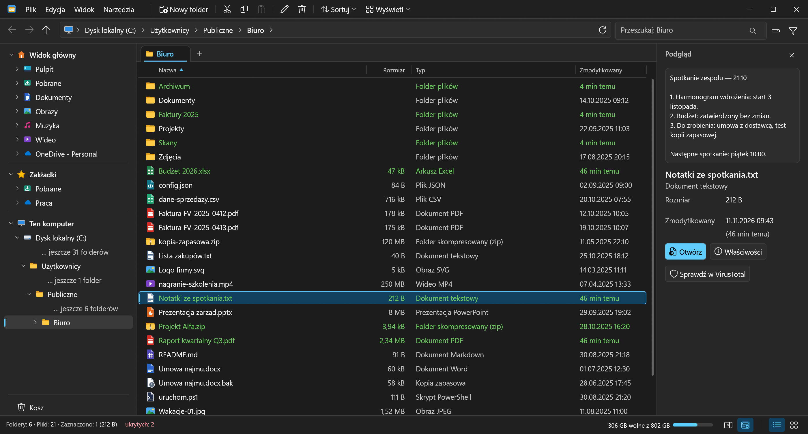
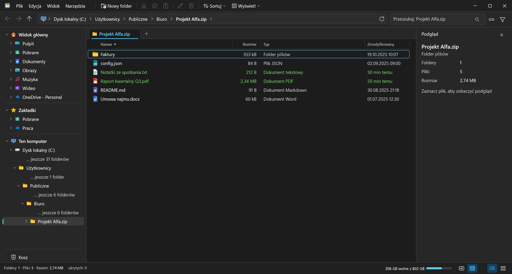
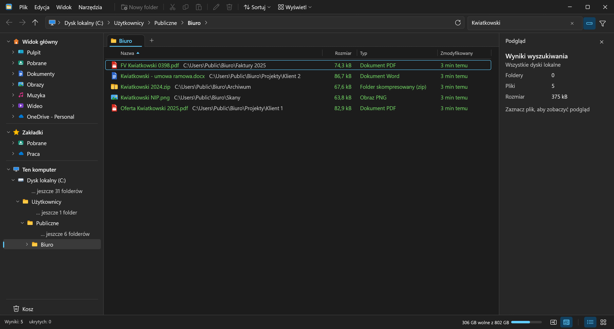
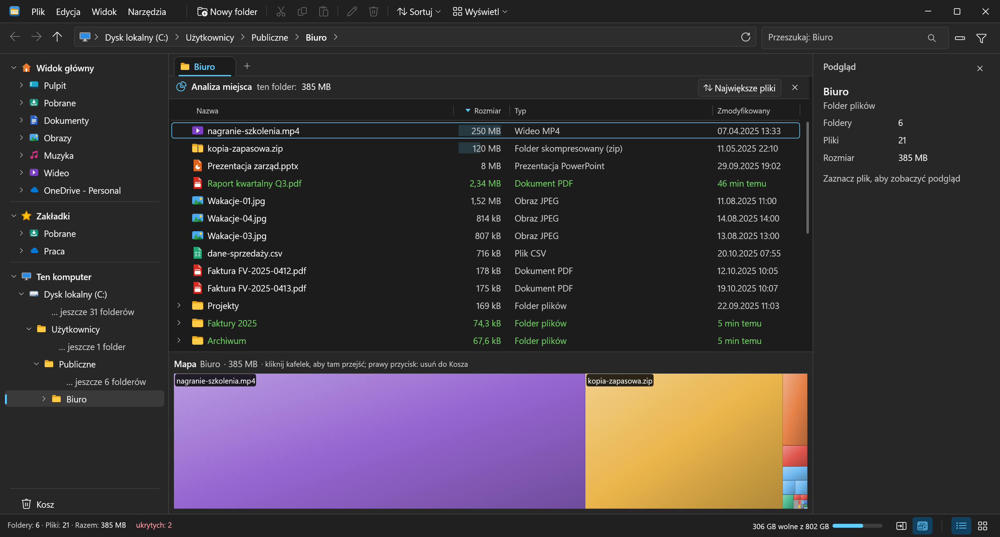
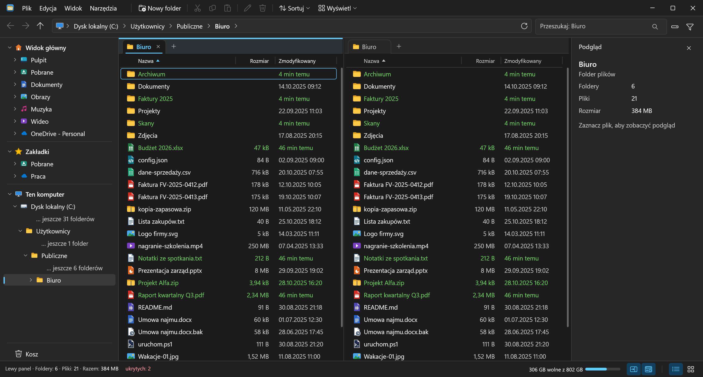
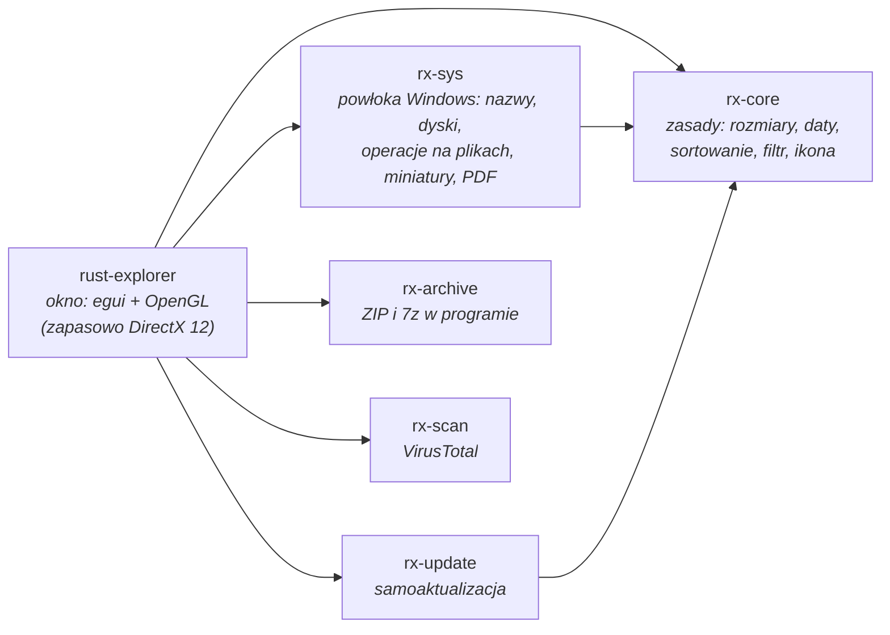

<p align="center">
  <a href="README.md">English</a> | <b>Polski</b>
</p>

<p align="center">
  
</p>

<h1 align="center">RustExplorer</h1>

<p align="center">
  <b>Szybki, dwupanelowy menedżer plików dla Windows 11, napisany w Rust.</b><br>
  Jeden plik <code>.exe</code> (~18 MB), bez instalatora, bez .NET, bez Electrona.
</p>

<p align="center">
  <b><a href="https://github.com/jarx-dev/RustExplorer/releases/latest">Pobierz najnowszą wersję</a></b>
</p>

<p align="center">
  
  <br><sub>Wszystkie zrzuty pokazują folder z danymi demonstracyjnymi (zmyślone pliki).</sub>
</p>

> **English in short:** a fast tabbed, dual-pane file manager for Windows 11 written in Rust with
> [egui](https://github.com/emilk/egui). Single ~18 MB EXE, preview pane for images, PDFs and text,
> archives browsed and edited like folders (ZIP, 7z; RAR read-only), instant file-name search
> across all local drives, a disk space map, natural sorting, wildcard filter, folder sizes, flat view, the Windows clipboard, drag and drop
> both ways, Explorer's own context menu, undo, a dark theme, and a self-updater that pulls new
> releases from GitHub (or from your own server). The UI is in English by default, with Polish in
> File ▸ Settings ▸ Language / Język.
>
> Interfejs jest domyślnie po angielsku; polski wybierzesz w Plik ▸ Ustawienia ▸ Language / Język
> (kto używał programu przed tą zmianą, zostaje przy polskim).

---

## Dlaczego?

Eksplorator Windows jest wygodny, dopóki nie trzeba porównać dwóch folderów, znaleźć pliku
w głębokim drzewie albo sprawdzić, co zjada miejsce na dysku. Klasyczne menedżery dwupanelowe
potrafią to wszystko, ale wyglądają jak z 2005 roku albo kosztują. RustExplorer jest pomiędzy:
wygląda i zachowuje się jak Windows 11, a pod spodem ma to, czego brakuje w Eksploratorze.

## Najważniejsze

### Archiwa jak foldery

ZIP, 7z i RAR otwierasz dwuklikiem jak zwykły folder: przeglądasz, podglądasz pliki i otwierasz je
bez wypakowywania całości. ZIP i 7z da się też zmieniać na miejscu: dorzucasz pliki przeciąganiem
lub wklejaniem, usuwasz je i zmieniasz nazwy, a program zapisuje archiwum od nowa w tle. Gdy plik otwarty
z archiwum zapiszesz w innym programie, RustExplorer zapyta, czy zaktualizować go w archiwum. RAR jest
tylko do odczytu i wypakowania. „Wypakuj tutaj”, „Wypakuj do folderu” i „Spakuj…” (ZIP albo 7z)
są w menu prawego klawisza; zaszyfrowane archiwum pyta o hasło. Wszystko działa w samym programie
(crate `rx-archive`), bez 7-Zipa i bez `tar.exe`, a postęp widać w panelu „Operacje”.



### Szukaj wszędzie

Przycisk z dyskiem obok pola szukania przełącza je z bieżącego folderu na wszystkie dyski lokalne, jak
w Everything, ale bez Everything i bez usługi administratora. Program ma własny indeks nazw na
dysku: wczytuje go dopiero przy pierwszym szukaniu, odświeża w tle co najwyżej co 10 minut
i zwalnia z pamięci 5 minut po ostatnim zapytaniu. Na dysku z 3 mln plików zapytanie trwa kilka
milisekund, polskie litery nie mają znaczenia (`zolw` znajdzie `żółw`), a przy każdym wyniku jest
jego folder.



### Analiza miejsca

Narzędzia ▸ Analiza miejsca pyta o zakres: cały dysk albo bieżący folder. Lista sortuje się
według rozmiaru i rozwija jak drzewo, a pod nią mapa kafelków pokazuje, co zajmuje miejsce.
Kliknięcie kafelka przechodzi do folderu, prawy przycisk usuwa do Kosza, a „Największe pliki”
pokazuje je razem, bez względu na folder. Mapa korzysta z indeksu dysków, więc cały dysk nie jest skanowany od nowa.



### Drzewo bez nadmiaru

Drzewo po lewej pokazuje tylko drogę do bieżącego folderu. Reszta każdego poziomu jest zwinięta
w „… jeszcze N folderów” i rozwija się kliknięciem, więc nawet w głębokim folderze drzewo mieści się
na ekranie. Pełne drzewo włączysz w Plik ▸ Ustawienia ▸ Pełne drzewo folderów.

### Dwa panele

`F3` dzieli okno na dwa panele, każdy ze swoimi kartami, filtrem i szukaniem. Przeciągasz pliki
między panelami albo karty na podział.



### Świeże pliki na zielono

Pliki i foldery utworzone lub zmienione w ostatnich 3 godzinach mają zieloną czcionkę w całym
wierszu, a zamiast daty pokazują „40 min temu”. Liczy się też świeże utworzenie, więc plik
skopiowany przed chwilą świeci na zielono, choć jego data zmiany jest stara. Widać to na zrzutach
wyżej: trzy pliki zmienione przed chwilą i foldery, do których coś dopiero trafiło. Nie trzeba
sortować po dacie, żeby zobaczyć, co się właśnie zmieniło.

### Sortowanie zapamiętane dla folderu

Każdy folder pamięta swoje sortowanie: posortujesz „Pobrane” od najnowszych, a „Faktury” według
nazwy, i każdy otworzy się tak, jak go zostawiłeś, także po ponownym uruchomieniu. Folder
posortowany zwyczajnie (Nazwa rosnąco) niczego nie zapamiętuje. Gdy chcesz przenieść jedno
sortowanie na kolejne foldery, Plik ▸ Ustawienia ▸ „Blokada formatu (zachowaj sortowanie)” trzyma je przy
przechodzeniu; plakietka na pasku stanu wyłącza blokadę.

## Co potrafi

| | |
|---|---|
| 🗂️ **Karty i podział** | Karty jak w przeglądarce (`Ctrl+T`, `Ctrl+W`), widok z podziałem na dwa panele (`F3`), każdy ze swoimi kartami. Układ wraca po ponownym uruchomieniu. |
| 👁️ **Podgląd** | Zdjęcia (PNG, JPG, GIF, BMP, WebP, ICO, TIFF), pierwsza strona PDF, pliki tekstowe i kod, podsumowanie folderu, a dla reszty miniatura z powłoki Windows. Plik, który jest tylko w chmurze, nie jest pobierany dla podglądu: widać jego miniaturę i przycisk „Pobierz, aby zobaczyć podgląd”. |
| 🖼️ **Trzy widoki** | Szczegóły, miniatury oraz szczegóły z miniaturami. Szerokość każdej kolumny zmieniasz, przeciągając jej granicę w nagłówku (dwuklik na granicy Nazwy przywraca wypełnianie); w wąskim panelu kolumny chowają się same. |
| 🔢 **Sortowanie naturalne** | `Zeszyt2` przed `Zeszyt10`, wielkość liter bez znaczenia; każdy folder pamięta swoje sortowanie. |
| 🔍 **Szukanie i filtr** | Pole szukania w bieżącym folderze; lejek obok przełącza je w filtr `*.pdf;*.jpg` albo po prostu `faktura` (dopasuje gdziekolwiek w nazwie), który dotyczy tylko bieżącej karty (w widoku dwóch paneli każdy panel ma własny) i zostaje przy zmianie folderu. |
| 🟩 **Co nowego?** | Pliki utworzone lub zmienione w ostatnich 3 godzinach mają zieloną czcionkę i „N min temu” zamiast daty. |
| 🌙 **Ciemny motyw** | Widok ▸ Motyw: Systemowy (jak ustawienie Windows, także zmienione w trakcie pracy), Jasny albo Ciemny. Kolory obu motywów są w `crates/rx-core/src/palette.rs`, a test sprawdza kontrast tekstu (WCAG, co najmniej 4,5:1 w ciemnym). |
| 📏 **Rozmiary folderów** | Jednym kliknięciem, w tle, bez blokowania okna. |
| 🪜 **Widok płaski** | Wszystkie pliki z podfolderów na jednej liście (do 20 000), z filtrem i sortowaniem. |
| 💽 **Ten komputer** | Dyski z paskiem zajętości (czerwony powyżej 90%), system plików, dyski sieciowe. |
| ⭐ **Zakładki** | Ulubione foldery w drzewie po lewej, obok szybkiego dostępu. |
| 🌳 **Drzewo ścieżki** | Drzewo po lewej pokazuje tylko drogę do bieżącego folderu; „… jeszcze N folderów” rozwija dany poziom, a Plik ▸ Ustawienia ▸ Pełne drzewo folderów pokazuje wszystkie. |
| 🧰 **Narzędzia** | Kopia `.bak` jednym skrótem (`Ctrl+B`), wypakowanie ZIP, terminal w bieżącym folderze, kopiowanie ścieżki (z dysku sieciowego Samby jako ścieżka linuksowa `/home/<użytkownik>/…`), „Blokada formatu (zachowaj sortowanie)”. |
| 📋 **Schowek i przeciąganie** | Kopiuj i Wytnij kładą pliki w schowku Windows (jak Eksplorator), więc wklejasz je w Eksploratorze, na pulpicie czy w poczcie, a pliki skopiowane tam wklejasz tutaj; elementy archiwów zostają w schowku programu. Pliki z innych programów upuszczasz na listę albo na folder (kopia, z `Shift` przeniesienie), a wiersz przeciągnięty poza okno idzie dalej jako zwykłe przeciąganie Windows. |
| 🪟 **Menu Windows** | „Więcej opcji Windows…” na końcu menu prawego klawisza (albo `Shift`+prawy klik) pokazuje menu Eksploratora dla zaznaczenia: „Wyślij do”, „Otwórz za pomocą”, 7-Zip, Git, „Zwolnij miejsce” i „Zawsze zachowuj na tym urządzeniu” w OneDrive. |
| ↩️ **Cofnij** | `Ctrl+Z` cofa ostatnie operacje (do 30): usunięcie do Kosza (przywrócenie z Kosza), przeniesienie (z powrotem), kopiowanie (kopie do Kosza, tylko nowo utworzone), zmianę nazwy, nowy folder i kopię `.bak`; nigdy niczego nie nadpisuje, a element zmieniony od tamtej pory pomija. Czego cofnąć się nie da (usunięcie z dysku bez Kosza, zmiany w archiwach, pliki zastąpione przy kopiowaniu), mówi pasek stanu; poleceń z menu Windows program nie cofa. |
| 🔄 **Samoaktualizacja** | Nowa wersja instaluje się sama, gdy nic nie robisz; jeśli się nie uruchomi, wraca poprzednia. Szczegóły niżej. |
| 📌 **Zasobnik** | Ikona przy zegarze; kliknięcie jej pokazuje albo chowa okno. Zamknięcie okna chowa je do zasobnika (bez przycisku na pasku zadań), a ponowne uruchomienie programu je przywraca; „Zakończ” kończy program. |

Kopiowanie i przenoszenie w programie idą jego własnym mechanizmem, z postępem w panelu
Operacje: kilka plików naraz (na dysku talerzowym po jednym), więc folder z tysiącami małych
plików kopiuje się kilka razy szybciej niż w Eksploratorze. Gdy nazwa w celu jest już zajęta,
przejmuje powłoka Windows ze swoim pytaniem o konflikt, podobnie przy dowiązaniach i folderach
wymagających zgody administratora. Przeciąganie plików do innych programów i `Ctrl+C` działają
jak w Eksploratorze. `Delete` przenosi do Kosza bez pytania, jak
w Windows 11; plik, który nie zmieści się w Koszu (np. z dysku sieciowego), zostanie usunięty
na stałe dopiero po ostrzeżeniu powłoki.

### Skróty

| Skrót | Działanie | Skrót | Działanie |
|---|---|---|---|
| `Alt+←` / `Alt+→` | wstecz / dalej | `F2` | zmień nazwę |
| `Backspace`, `Alt+↑` | folder wyżej | `F3` | podział na dwa panele |
| `Enter` | otwórz | `F5` | odśwież |
| `Alt+Enter` | właściwości | `Delete` | do Kosza |
| `Ctrl+C` / `X` / `V` | kopiuj / wytnij / wklej | `Ctrl+Z` | cofnij |
| `Ctrl+A` | zaznacz wszystko | `Ctrl+B` | kopia `.bak` |
| `Ctrl+T` / `Ctrl+W` | nowa / zamknij kartę | `Ctrl+Shift+N` | nowy folder |
| `Ctrl+Shift+C` | kopiuj ścieżkę | `Ctrl` `+` / `−` / `0` | powiększenie |
| `↑` `↓` `Home` `End` | ruch po liście (z `Shift` zaznacza) | `PgUp` / `PgDn` | strona w górę / w dół |
| `Esc` | anuluje zmianę nazwy, czyści szukanie | środkowy przycisk na karcie | zamknij kartę |
| `Spacja` | wielkość zaznaczonych folderów (w kolumnie Wielkość) | | |

## Pod maską



- **`rx-core`** nie zna ani okna, ani Windows API, więc jego testy działają na każdym systemie
  (`cargo test -p rx-core`). Sortowanie naturalne porównuje nazwy w miejscu, bez przydziału
  pamięci przy każdym porównaniu; test pilnuje, że wynik jest identyczny jak w pierwszej,
  prostszej wersji.
- **`rx-sys`** to cienka warstwa nad `windows-rs`: `SHFileOperation`, `IShellItemImageFactory`
  dla miniatur, `Windows.Data.Pdf` dla podglądu PDF. Moduł `watch` śledzi foldery widoczne na
  ekranie bez trzymania na nich uchwytu (inne programy mogą więc zmieniać nazwy folderów
  nadrzędnych): na stałych dyskach, których nie da się odłączyć, jeden wątek czyta zmiany całego
  woluminu (`ReadDirectoryChangesW` na jego katalogu głównym) i wybiera te, które dotyczą
  pokazanych folderów; na pozostałych (sieciowych, wymiennych, zewnętrznych, wirtualnych) drugi
  wątek porównuje listę co 10 s. Okno nie
  odpytuje dysku i w spoczynku nie budzi się samo; folder zapisywany bez przerwy odświeża się
  najwyżej raz na sekundę.
- **Okno nie czeka na dysk przy listowaniu.** Listę folderu (także archiwum), foldery w drzewie,
  dyski z nazwami i wolne miejsce czytają osobne wątki; wynik wraca komunikatem z numerem
  żądania, a liczy się tylko odpowiedź na najnowsze (`rx_core::Asked`), więc spóźniona lista
  folderu, z którego już wyszliśmy, niczego nie nadpisze. Do nadejścia listy karta pokazuje
  poprzednie wiersze albo „Wczytuję…”, a zaznaczenie nowego folderu, pliku po zmianie nazwy czy
  folderu, z którego wyszliśmy w górę, czeka na nią jako zapisany zamiar (`rx_core::Select`).
  Karty z poprzedniej sesji otwierają się bez pytania dysku, więc niedostępny dysk sieciowy nie
  wstrzymuje startu: jego karta pokaże błąd na liście, gdy system przestanie na niego czekać.
  Podgląd buduje osobny wątek (z serii zaznaczeń tylko ostatnie), a plik, który jest tylko
  w chmurze, nie jest dla niego czytany.
- **Miniatury**: najwyżej 500 tekstur, a po przekroczeniu znikają najdawniej rysowane; wątek
  wczytuje je w kolejności zamawiania i pomija kafelki, które zdążyły zniknąć z ekranu. Folder
  3000 plików przewinięty do końca w Miniaturach zajmuje 141 MB pamięci prywatnej (przed limitem
  364 MB), a folder 12 000 plików staje na ok. 185 MB.
- **Schowek, przeciąganie i menu Windows** (`rx-sys`: moduły `clip` i `menu`): Kopiuj i Wytnij
  kładą w schowku ten sam obiekt danych co Eksplorator (`CF_HDROP` z „Preferred DropEffect”,
  `OleSetClipboard`, zostaje po zamknięciu programu), a przeciąganie na zewnątrz podaje go
  `SHDoDragDrop`; o przeniesieniu decyduje cel, program sam nic nie usuwa. Menu Windows to
  `IContextMenu` powłoki pokazane przy kursorze; elementy menu czyta wątek w tle, więc dysk
  sieciowy, który nie odpowiada, nie zamraża okna.
- **`rx-update`** sprawdza plik `latest.json` co minutę, a przy oknie zminimalizowanym lub w zasobniku
  co 15 minut, pobiera nowszy build, weryfikuje rozmiar,
  SHA-256 i nagłówek EXE, a podmienia program dopiero, gdy okno jest zminimalizowane, schowane albo nieużywane
  i nic nie pracuje: ani własne kopiowanie programu, ani wątek, który powłoka uruchomiła w procesie
  dla polecenia z menu Windows (np. „Wyślij do” na pendrive; program daje powłoce odniesienie do
  procesu przez `SHSetInstanceExplorer` i widzi, że jest trzymane).
  Stara wersja zostaje „strażnikiem”: jeśli nowa nie narysuje okna w 3 minuty, wraca poprzednia,
  a nieudany build nie zostanie zainstalowany drugi raz. Zwykły HTTP jest dozwolony tylko dla
  adresów Tailscale (`100.64.0.0/10`, `fd7a:115c:a1e0::/48`, `*.ts.net`) i localhost, wszędzie
  indziej tylko HTTPS; przekierowania tylko z HTTPS na HTTPS (tak działają wydania z GitHuba).
- **Ikona** jest rysowana w kodzie (`crates/rx-core/src/icon.rs`, funkcje odległości od
  zaokrąglonych prostokątów): z niej powstaje ikona okna i zasobnika, a `rust-explorer.exe
  --save-icon ikona.ico` zapisuje ją do pliku, który `build.rs` wbudowuje w EXE (build MSVC).
- **Manifest** (`rustexplorer.manifest`, wbudowany przez `build.rs` razem z ikoną): `asInvoker`
  (bez praw administratora), zgodność z Windows 10/11 i `longPathAware` (gdy w Windows włączono
  `LongPathsEnabled`). Ten wpis zdejmuje limit 260 znaków tylko z bezpośrednich wywołań Win32
  (cofnięcie zmiany nazwy, „Zawsze zachowuj na tym urządzeniu”, obserwator folderów); listowanie,
  nowy folder i zmiana nazwy idą przez `std::fs`, które obchodzi limit i bez manifestu. Własne
  kopiowanie i przenoszenie programu same dodają do długich ścieżek prefiks `\\?\`. Usuwanie,
  kopiowanie i przenoszenie przez powłokę (`SHFileOperationW`), otwieranie, właściwości, menu Windows i miniatury
  to wywołania powłoki, których ten wpis nie obejmuje: przy ścieżkach ponad 260 znaków mogą nadal
  zawodzić (niesprawdzone). Bez wpisów DPI, kontrolek i motywu, więc wygląd się nie zmienia; bez
  sterty segmentowej: 1–2 MB mniej pamięci prywatnej z ok. 112 MB, a CPU przy miniaturach nie
  lepsze (10,2–10,7 s wobec 9,2–10,1 s, po dwa przebiegi).
- **Pasek tytułu** jest rysowany przez program, ale najechanie na „Maksymalizuj” pokazuje
  systemowe menu układów przyciągania: podklasa okna (`rx-sys/src/caption.rs`) odpowiada Windows
  `HTMAXBUTTON` nad prostokątem tego przycisku. Minimum okna to 420×320 pt (`MIN_SIZE`): ikona,
  cztery menu i przyciski okna jeszcze się mieszczą, a Microsoft wymaga najwyżej 500, więc okno
  wypełnia też wąskie strefy. W wąskim oknie znikają kolejno przyciski paska narzędzi, drzewo
  (poniżej 480 pt), podgląd (poniżej 700 pt), pole wyszukiwania i wolne miejsce na pasku stanu.
- **Tryb zrzutu** (`--screenshot <plik.png>`) służy testom: osobny, wyrzucany układ, bez
  zasobnika i aktualizacji, a okno jest zasłonięte przez DWM (rysuje się normalnie, ale nie
  pojawia się na ekranie, nie bierze fokusu i nie ma przycisku na pasku zadań), więc testy mogą
  działać na używanym komputerze; `--visible` je pokazuje.

### Rozmiar

| | EXE |
|---|---|
| start (domyślne funkcje eframe/wgpu) | 18,1 MB |
| + LTO, `codegen-units = 1`, `strip` | 15,6 MB |
| + w wgpu tylko DirectX 12 (bez Vulkana, GL i Metala) | 13,8 MB |
| + ikona w zasobniku | 14,1 MB |
| + OpenGL jako główny renderer | 14,4 MB |
| dzisiejszy build (archiwa, VirusTotal, indeks, schowek, menu Windows…) | 17,9 MB |

### Pamięć

Pomiar na laptopie z Ryzenem i zintegrowaną grafiką Radeon 780M (folder z 3000 plików, okno 1600×860
przy skali 175%). Na zintegrowanej karcie pamięć GPU jest zwykłym RAM-em procesu.

| | working set | pamięć prywatna |
|---|---|---|
| DirectX 12, domyślne ustawienia wgpu | 430–460 MB | 430–455 MB |
| DirectX 12, `MemoryHints::MemoryUsage` | ~280 MB | ~280 MB |
| **OpenGL** (domyślnie), Szczegóły, okno bezczynne | **~109 MB** | **~113 MB** |
| OpenGL, Miniatury przewinięte do końca folderu | ~136 MB | ~141 MB |
| okno zminimalizowane lub schowane do zasobnika, po 3 s | **~1 MB** | bez zmian |

Większość tego, co zostaje, to sterownik grafiki: samo puste okno egui zajmuje prawie tyle samo.
Bezczynne okno nic nie robi: w 80 s rysuje ok. 122 klatki (prawie wszystkie przy starcie) i zużywa
ok. 0,01 s CPU na minutę.
Zminimalizowane okno nic nie rysuje, więc program oddaje wtedy swoje strony systemowi
(`SetProcessWorkingSetSize`) i Menedżer zadań pokazuje około 1 MB; wracają z pamięci podręcznej
przy pierwszym użyciu. Okno tylko przysłonięte innym dalej się rysuje i zostaje przy ~120 MB.
Razem z oddaniem pamięci proces przechodzi w tryb wydajności Windows 11 (EcoQoS) i wychodzi z niego
przy pokazaniu okna; trwające w tle kopiowanie, pakowanie czy skan indeksu go wstrzymują.
Ponowny skan indeksu, na który nikt nie czeka, działa w priorytecie tła Windows.

Program używa OpenGL. Jeśli sterownik OpenGL nie wystartuje, przełącza się na DirectX 12.

## Pobierz

Gotowy plik EXE jest w [wydaniach](https://github.com/jarx-dev/RustExplorer/releases/latest). Wystarczy go
pobrać i uruchomić, bez instalacji (Windows 10 lub 11). Kolejne wydania program pobiera sam.
Plik nie jest podpisany, więc za pierwszym razem Windows może ostrzec przed nieznanym wydawcą:
„Więcej informacji” → „Uruchom mimo to”.

## Budowanie

Na Windows:

```powershell
cargo build --release
# target\release\rust-explorer.exe
```

Na Linuksie (krzyżowo, bez Windows), przez [cargo-xwin](https://github.com/rust-cross/cargo-xwin):

```bash
cargo install cargo-xwin
cargo xwin build --release --target x86_64-pc-windows-msvc
cargo test -p rx-core -p rx-update -p rx-archive      # testy bez Windows
```

Wersja Rusta jest przypięta w `rust-toolchain.toml`.

Wydania na GitHubie buduje GitHub Actions (workflow „Wydanie”, uruchamiany ręcznie z `main`):
EXE, `latest.json` dla aktualizacji i atestacja pochodzenia pliku. Każdy PR i każda zmiana na
`main` przechodzi build i testy na Windows (workflow „CI”).

### Własny serwer aktualizacji

Zwykły build nigdy sam się nie aktualizuje. Aktualizuje się tylko build z wydania na GitHubie
(pobiera kolejne wydania) albo z `scripts/publish.sh`, który wbudowuje adres `latest.json` i tożsamość wersji. Skrypt potrzebuje `cargo-xwin` i `jq`:

```bash
mkdir -p ~/updates && (cd ~/updates && python3 -m http.server 8790 --bind <adres-tailscale>) &
RUSTEXPLORER_UPDATE_BASE=http://<adres-tailscale>:8790/rustexplorer \
RUSTEXPLORER_UPDATE_DIR=~/updates/rustexplorer \
scripts/publish.sh
```

`RUSTEXPLORER_UPDATE_DIR` to katalog z buildami, a `RUSTEXPLORER_UPDATE_BASE` to adres, pod
którym ten katalog widać (serwer działa w katalogu nadrzędnym). Adres jest wymagany; obie
zmienne można trzymać poza repozytorium w `~/.config/rustexplorer/build.env`. Zamiast
`http.server` może być dowolny serwer plików w sieci Tailscale albo HTTPS.

Te same zmienne podane przy `scripts/auto-publish.sh --install` trafiają do timera systemd, który
co minutę buduje i publikuje każdy nowy commit na `main`. Na komputerze z programem
`RUSTEXPLORER_UPDATE_URL=off` wyłącza aktualizacje, a inny adres `latest.json` w tej zmiennej
kieruje je gdzie indziej. Przebieg aktualizacji zapisuje się w `%APPDATA%\RustExplorer\update.log`.

## O autorze

RustExplorera napisał **Jarosław Hartwich** ([github.com/jarx-dev](https://github.com/jarx-dev)).
To samo znajdziesz w programie: Plik → „O programie”.

Jeśli RustExplorer Ci się przydaje, możesz [postawić mi kawę](https://buymeacoffee.com/jarx) ☕

## Licencja

[MIT](LICENSE). Katalog `patches/windows-link` to łatka crate'a
[windows-link](https://crates.io/crates/windows-link) (MIT/Apache-2.0) dla buildu GNU.
