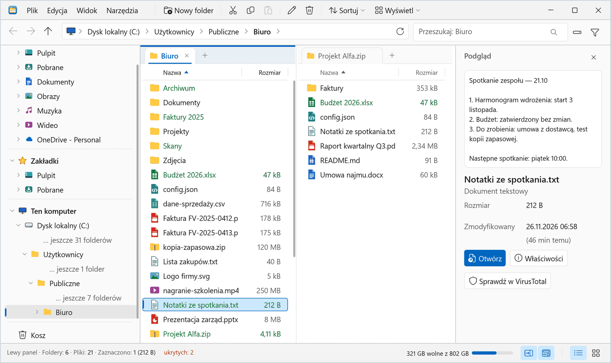
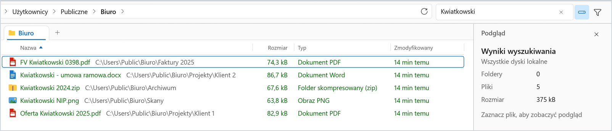
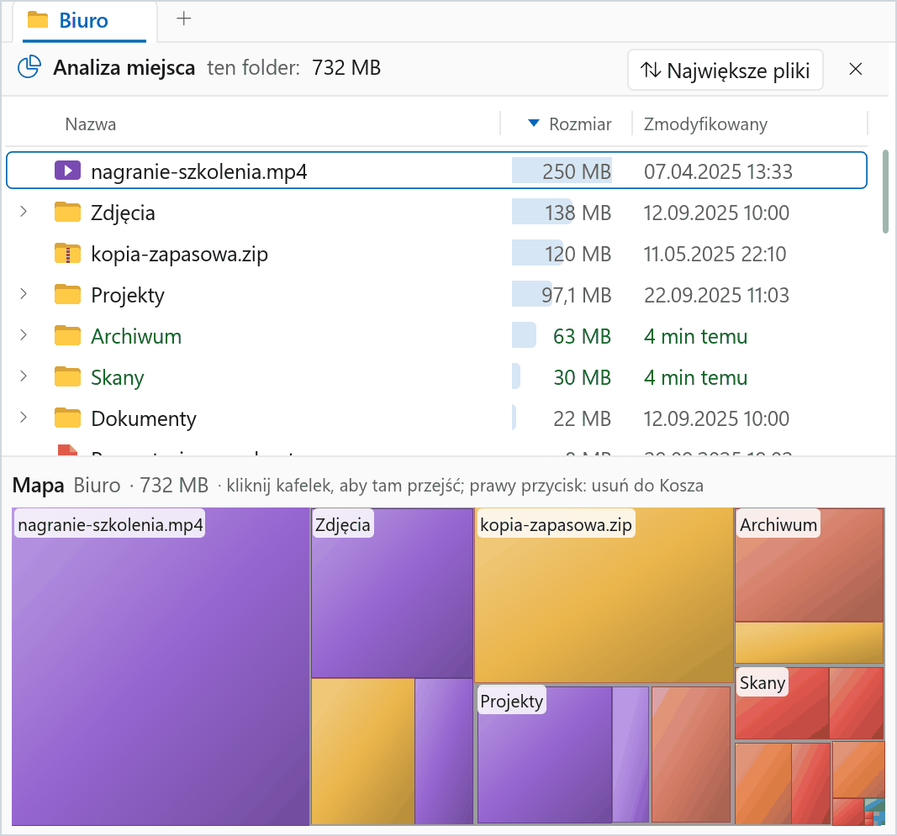
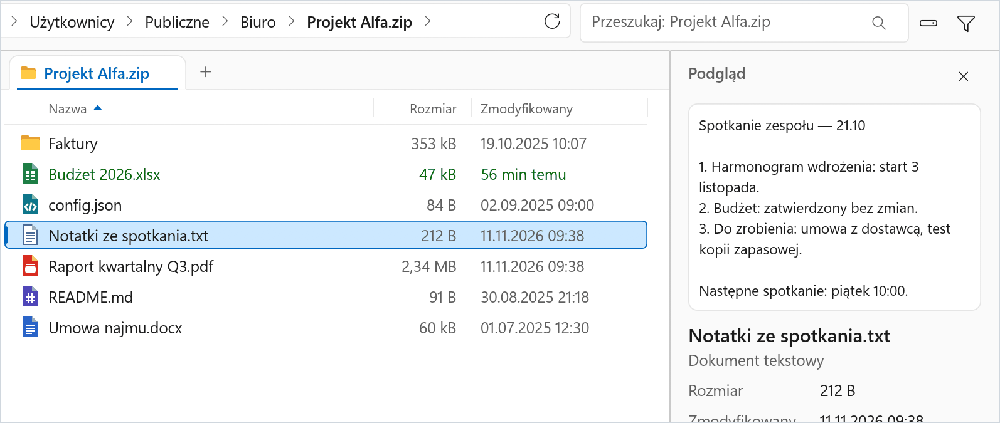
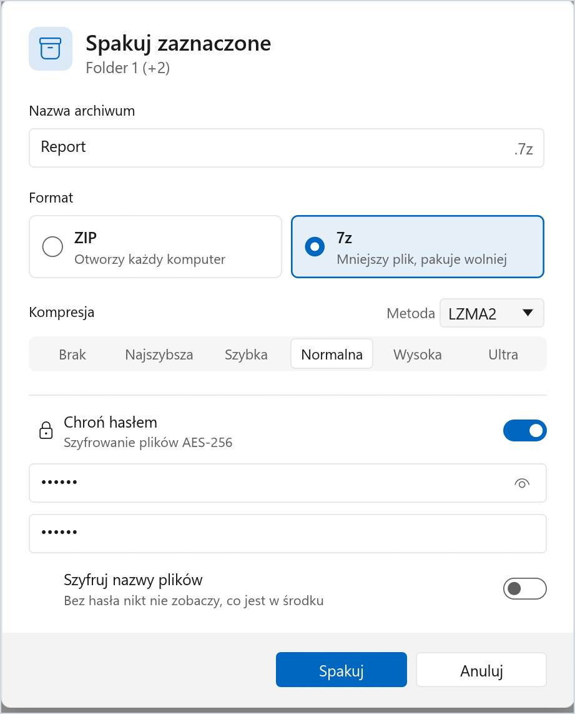
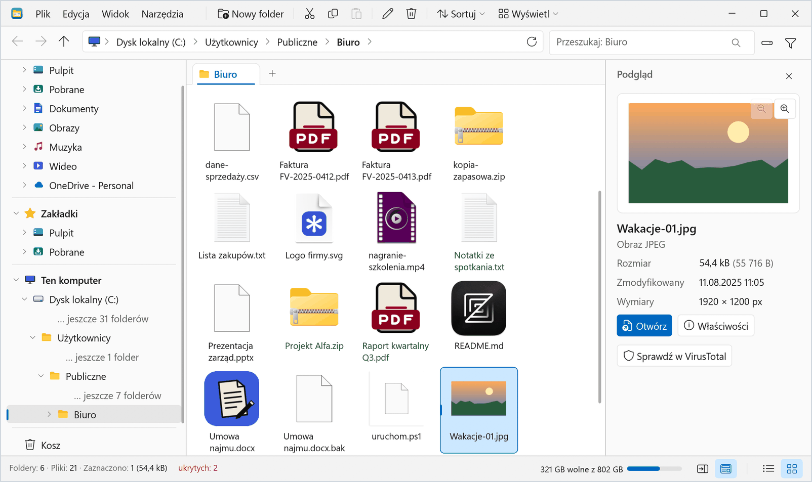
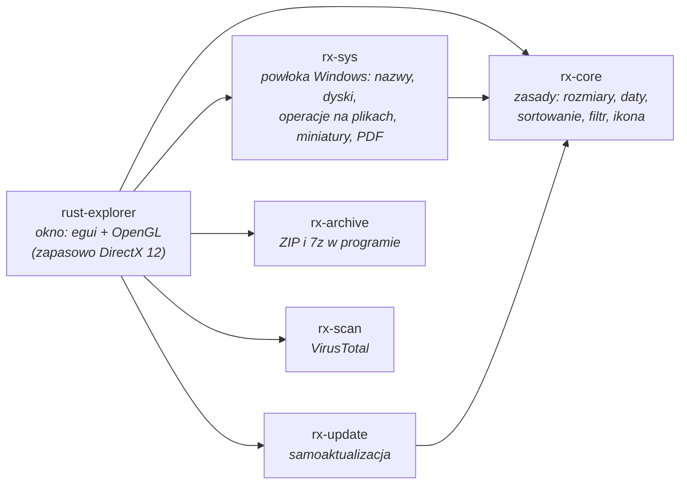

<div align="center">

<a href="README.md">English</a> | <b>Polski</b>


# RustExplorer

**Darmowy menedżer plików dla Windows 10 i 11: dwa panele z kartami, ZIP i 7z edytowane jak foldery,
szukanie po nazwie na wszystkich dyskach lokalnych w milisekundach i mapa tego, co zajmuje dysk.**

<a href="https://github.com/jarx-dev/RustExplorer/releases/latest"></a>

<sub>Przenośny EXE ~19 MB · weź `RustExplorer-….exe` z listy Assets · bez podpisu cyfrowego ([pierwsze uruchomienie](#pobierz-i-uruchom))</sub>

[](https://github.com/jarx-dev/RustExplorer/releases/latest)
[](https://github.com/jarx-dev/RustExplorer/releases/latest)
[](https://github.com/jarx-dev/RustExplorer/actions/workflows/ci.yml)
[](LICENSE)


<picture>
  <source media="(prefers-color-scheme: dark)" srcset="docs/screenshots/pl/hero-dark.png">
  
</picture>

<sub>Z lewej: folder, pliki zmienione w ostatnich 3 godzinach na zielono. Z prawej: ZIP otwarty jak folder, z dopiero co dodanym plikiem. `F3` dzieli okno. Wszystkie zrzuty pokazują zmyślone dane demonstracyjne.</sub>

[Dlaczego warto](#dlaczego-warto) · [Eksplorator Windows](#rustexplorer-i-eksplorator-windows) · [Wycieczka](#krótka-wycieczka) · [Pobierz](#pobierz-i-uruchom) · [Prywatność](#prywatność-w-skrócie) · [Dla programistów](#dla-programistów)

</div>

## Dlaczego warto

- **Dwa foldery obok siebie w jednym oknie.** `F3` dzieli je na dwa panele, każdy ze swoimi kartami;
  pliki przeciągasz z jednego do drugiego, a kartę na podział.
- **5–7 razy szybciej niż kopiowanie powłoki Windows, którego używał wcześniej, przy tysiącach małych plików.** Własny mechanizm
  kopiowania programu bierze kilka plików naraz: 5000 plików po 20 KB zajęło 1,1–1,6 s na dysku NVMe SSD, wobec 8,3 s przez kopiowanie
  powłoki Windows, którego program używał wcześniej ([pomiary](#wydajność)).
- **Znajduje plik po nazwie na wszystkich dyskach lokalnych naraz**: 2–4 ms na zapytanie przy ok. 3 mln
  nazw (plików i folderów) we własnym indeksie, który buduje i odświeża skan w tle trwający ok. 30 s ([pomiary](#wydajność)). Bez Windows Search,
  bez Everything, bez usługi systemowej.
- **Pokazuje, co zajmuje dysk**: lista według rozmiaru obok mapy kafelków; kliknięcie otwiera folder,
  prawy przycisk proponuje usunięcie do Kosza.
- **Archiwa, które można zmieniać.** ZIP, 7z i RAR otwierają się jak foldery; podgląd i otwarcie pliku
  bez wypakowywania całego archiwum, a w ZIP i 7z dodajesz, usuwasz i zmieniasz nazwy plików.
- **Od razu widać, co się zmieniło.** Pliki i foldery utworzone lub zmienione w ostatnich 3 godzinach
  są zielone i pokazują „40 min temu” zamiast daty. Pasek stanu w każdym folderze mówi, ile plików jest ukrytych.
- **Lekki dla komputera.** Ok. 113 MB pamięci prywatnej przy otwartym oknie; po zminimalizowaniu albo
  w zasobniku Menedżer zadań pokazuje ok. 1 MB w użyciu (working set; pamięć prywatna się nie zmienia). Bezczynne okno zużywa ok. 0,01 s CPU na minutę.

## RustExplorer i Eksplorator Windows

Każde zdanie o Eksploratorze ma link do dokumentacji Microsoftu; kreska znaczy, że nic o tym tam
nie znaleźliśmy.

| | **RustExplorer** | **Eksplorator plików** (Windows 11) |
|---|---|---|
| **Dwa foldery obok siebie** | **Tak**: `F3`, każdy panel z własnymi kartami | **Karty i osobne okna** (`Ctrl+T`, `Ctrl+N`) ([Microsoft](https://support.microsoft.com/pl-pl/accessibility/windows/keyboard-shortcuts-in-windows)) |
| **Archiwa** | **ZIP, 7z, RAR jak foldery**; ZIP i 7z zmieniane na miejscu; zaszyfrowane pytają o hasło przy wypakowaniu całego archiwum | **ZIP jak folder**; czyta RAR, 7z i TAR, tworzy ZIP, 7z i TAR (24H2); „nie obsługuje operacji na zaszyfrowanych plikach archiwum” ([Microsoft](https://support.microsoft.com/pl-pl/windows/experience/storage-filemanagement/zip-and-unzip-files), [24H2](https://learn.microsoft.com/pl-pl/windows/whats-new/whats-new-windows-11-version-24h2)) |
| **Szukanie nazw na dyskach** | **Własny indeks** wszystkich dysków lokalnych, wczytywany przy szukaniu | **Indeks Windows Search**: domyślnie Dokumenty, Obrazy, Muzyka i pulpit, cały komputer w trybie „Rozszerzonym” ([Microsoft](https://support.microsoft.com/pl-pl/windows/experience/performance-optimization/search-indexing-in-windows)) |
| **Co zajmuje dysk** | **Lista według rozmiaru i mapa kafelków**, dla dysku albo folderu | **Ustawienia ▸ Magazyn**, według kategorii, np. aplikacje i pliki tymczasowe ([Microsoft](https://support.microsoft.com/pl-pl/windows/experience/storage-filemanagement/storage-settings-in-windows)) |
| **Świeżo zmienione pliki** | **Zielone przez 3 godziny**, od razu po uruchomieniu | — |
| **Cofanie** | **`Ctrl+Z`**, do 30 operacji | **`Ctrl+Z`**, „cofnięcie poprzedniej akcji” ([Microsoft](https://support.microsoft.com/pl-pl/accessibility/windows/keyboard-shortcuts-in-windows)) |
| **Cena** | **Darmowy**, otwarty kod (MIT) | **Część Windows** |
| **Jak zdobyć** | **Jeden plik EXE ~19 MB**, nic do instalowania, aktualizuje się sam | **Wbudowany** |

## Krótka wycieczka

### Szukaj wszędzie

Przycisk z dyskiem obok pola szukania przełącza je z bieżącego folderu na wszystkie dyski lokalne.
Program ma własny indeks nazw plików na dysku: wczytuje go przy szukaniu (i co jakiś czas skanuje dyski od nowa w tle,
gdy szukasz) i zwalnia z pamięci 5 minut po ostatnim zapytaniu. Polskie litery nie mają
znaczenia (`zolw` znajdzie `żółw`), a przy każdym wyniku jest jego folder.

<picture>
  <source media="(prefers-color-scheme: dark)" srcset="docs/screenshots/pl/find-dark.png">
  
</picture>

### Co zajmuje dysk

Narzędzia ▸ Analiza miejsca pyta o zakres: cały dysk albo bieżący folder. Lista sortuje się według
rozmiaru i rozwija jak drzewo, a mapa kafelków pod nią pokazuje, co zajmuje miejsce. Kliknięcie
kafelka przechodzi do folderu (przy pliku pokazuje go w jego folderze), prawy przycisk daje Otwórz,
Kopiuj ścieżkę i Usuń do Kosza, a „Największe pliki” pokazuje je razem, bez względu na folder. Mapa
korzysta z tego samego indeksu co szukanie (nazwy i rozmiary, odświeżany w tle, gdy jest stary), a nie
z nowego skanu dysku.

<picture>
  <source media="(prefers-color-scheme: dark)" srcset="docs/screenshots/pl/space-dark.png">
  
</picture>

### Archiwa jak foldery

ZIP, 7z i RAR otwierasz dwuklikiem jak folder: przeglądasz, podglądasz
pliki i otwierasz je bez wypakowywania całości. W ZIP i 7z dorzucasz pliki (przeciąganiem lub
wklejaniem), usuwasz je i zmieniasz nazwy (plik dodany do zaszyfrowanego ZIP-a trafia tam bez hasła), a program zapisuje archiwum od nowa w tle i podmienia
oryginał dopiero, gdy nowe jest gotowe; gdy plik otwarty z ZIP albo 7z zapiszesz w innym programie
w ciągu 4 godzin, RustExplorer zaproponuje odłożenie go z powrotem. RAR jest tylko do odczytu. „Wypakuj tutaj”,
„Wypakuj do folderu” i „Spakuj…” są w menu prawego klawisza, wszystko bez 7-Zipa.

<picture><source media="(prefers-color-scheme: dark)" srcset="docs/screenshots/pl/archive-dark.png"></picture>

<sub>W środku ZIP: dopiero co dodany plik (zielony) i podgląd</sub>

<p align="center"><picture><source media="(prefers-color-scheme: dark)" srcset="docs/screenshots/pl/pack-dark.png"></picture><br><sub>Spakuj… jako ZIP albo 7z, z hasłem</sub></p>

### Miniatury, podgląd i świeże pliki

Trzy widoki: szczegóły, miniatury oraz szczegóły z miniaturami. Podgląd pokazuje zdjęcia, pierwszą stronę
PDF, tekst i kod. Pliki zmienione w ostatnich 3 godzinach są zielone w każdym widoku; liczy się też plik
dopiero co skopiowany, choć jego data zmiany jest stara. Pasek stanu liczy ukryte pliki, na czerwono,
gdy jakieś są ukryte; kliknięcie je pokazuje.

<picture>
  <source media="(prefers-color-scheme: dark)" srcset="docs/screenshots/pl/thumbs-dark.png">
  
</picture>

## Wszystko, co potrafi

<details>
<summary><b>Pełna lista funkcji</b> (18 wierszy)</summary>

| Funkcja | Co robi |
|---|---|
| 🗂️ **Karty i podział** | Karty jak w przeglądarce (`Ctrl+T`, `Ctrl+W`), dwa panele (`F3`), każdy ze swoimi kartami; układ wraca po ponownym uruchomieniu. |
| 👁️ **Podgląd** | Zdjęcia (PNG, JPG, GIF, BMP, WebP, ICO, TIFF), pierwsza strona PDF, tekst i kod, podsumowanie folderu, a dla reszty miniatura z Windows. Plik tylko w chmurze nie jest dla niego pobierany. |
| 🖼️ **Trzy widoki** | Szczegóły, miniatury, szczegóły z miniaturami. Kolumny zmieniasz przeciąganiem; w wąskim panelu chowają się same. |
| 🔢 **Sortowanie naturalne** | `Zeszyt2` przed `Zeszyt10`. Każdy folder pamięta swoje sortowanie, także po ponownym uruchomieniu; Plik ▸ Ustawienia ▸ „Blokada formatu” przenosi jedno sortowanie na kolejne foldery. |
| 🔍 **Szukanie i filtr** | Szukanie w bieżącym folderze albo filtr, np. `*.pdf;*.jpg` lub `faktura`, który zostaje z kartą. |
| 📏 **Rozmiary folderów** | Jednym kliknięciem (albo `Spacją` na zaznaczonych folderach), liczone w tle. |
| 🪜 **Widok płaski** | Wszystkie pliki z podfolderów na jednej liście (do 20 000), z filtrem i sortowaniem. |
| 🌳 **Drzewo ścieżki** | Drzewo pokazuje tylko drogę do bieżącego folderu; „… jeszcze N folderów” rozwija poziom. Pełne drzewo jest w Plik ▸ Ustawienia. |
| 💽 **Ten komputer i zakładki** | Dyski z paskiem zajętości (czerwony powyżej 90%) i systemem plików; ulubione foldery w drzewie. |
| 📋 **Schowek i przeciąganie** | Kopiuj i Wytnij używają schowka Windows, więc pliki idą do i z Eksploratora, pulpitu czy programu pocztowego (elementy archiwów zostają w schowku programu); pliki z innych programów upuszczasz na listę, folder albo kartę. |
| 🪟 **Menu Windows** | „Więcej opcji Windows…” (albo `Shift`+prawy klik) otwiera menu Eksploratora: „Wyślij do”, „Otwórz za pomocą”, 7-Zip, Git, OneDrive. |
| ↩️ **Cofnij** | `Ctrl+Z` cofa do 30 operacji: usunięcie do Kosza, przeniesienie, kopiowanie, zmianę nazwy, nowy folder, kopię `.bak`. Nigdy niczego nie nadpisuje; czego cofnąć się nie da, mówi pasek stanu. |
| ⏳ **Operacje** | Jeden panel na kopiowanie, przenoszenie, wypakowywanie i sprawdzanie w VirusTotal ze wszystkich kart, z szybkością i historią; własne kopiowanie i przenoszenie programu można też wstrzymać i anulować. |
| 🧰 **Narzędzia** | Kopia `.bak` pliku (`Ctrl+B`, także w menu prawego klawisza), terminal w bieżącym folderze, kopiowanie ścieżki. |
| 🛡️ **VirusTotal** | „Sprawdź w VirusTotal” w menu prawego klawisza szuka pliku po SHA-256; sam plik opuszcza komputer tylko wtedy, gdy zdecydujesz się go wysłać. Potrzebny darmowy klucz API. |
| 🌙 **Jasny i ciemny** | Widok ▸ Motyw: Systemowy, Jasny albo Ciemny; test pilnuje kontrastu tekstu co najmniej 4,5:1 (WCAG) w ciemnym motywie. |
| 🔄 **Samoaktualizacja** | Nowe wydanie instaluje się samo, gdy nic nie robisz; jeśli się nie uruchomi, wraca poprzednie. |
| 📌 **Zasobnik** | Zamknięcie okna chowa je przy zegarze; ponowne uruchomienie programu je przywraca. |

</details>

<details>
<summary><b>Kopiowanie, usuwanie i konflikty dokładniej</b></summary>

Kopiowanie i przenoszenie w programie idą jego własnym mechanizmem, z postępem w panelu Operacje:
kilka plików naraz (na dysku talerzowym po jednym). Gdy nazwa w celu jest już zajęta, przejmuje
powłoka Windows ze swoim pytaniem o konflikt, podobnie przy dowiązaniach i folderach wymagających zgody
administratora. Przeciąganie plików do innych programów i `Ctrl+C` działają jak w Eksploratorze.
`Delete` przenosi do Kosza bez pytania, jak w Windows 11; plik, który nie zmieści się w Koszu
(np. z dysku sieciowego), zostanie usunięty na stałe dopiero po ostrzeżeniu powłoki. Cofanie
przywraca z Kosza, przenosi z powrotem, nowe kopie wysyła do Kosza i pomija element zmieniony od
tamtej pory; usunięcia bez Kosza, zmian w archiwach i plików zastąpionych przy kopiowaniu cofnąć
się nie da, a poleceń z menu Windows program nie cofa.

</details>

<details>
<summary><b>Skróty klawiszowe</b></summary>

| Skrót | Działanie | Skrót | Działanie |
|---|---|---|---|
| `Alt+←` / `Alt+→` | wstecz / dalej | `F2` | zmień nazwę |
| `Backspace`, `Alt+↑` | folder wyżej | `F3` | podział na dwa panele |
| `Enter` | otwórz | `F5` | odśwież |
| `Alt+Enter` | właściwości | `Delete` | do Kosza |
| `Ctrl+C` / `X` / `V` | kopiuj / wytnij / wklej | `Ctrl+Z` | cofnij |
| `Ctrl+A` | zaznacz wszystko | `Ctrl+B` | kopia `.bak` |
| `Ctrl+T` / `Ctrl+W` | nowa / zamknij kartę | `Ctrl+Shift+N` | nowy folder |
| `Ctrl+Shift+C` | kopiuj ścieżkę | `Ctrl` `+` / `−` / `0` | powiększenie |
| `↑` `↓` `Home` `End` | ruch po liście (z `Shift` zaznacza) | `PgUp` / `PgDn` | strona w górę / w dół |
| `Esc` | anuluje zmianę nazwy, czyści szukanie | środkowy przycisk na karcie | zamknij kartę (nie przypiętą) |
| `Spacja` | wielkość zaznaczonych folderów (w kolumnie Wielkość) | | |

</details>

## Czego nie robi

- **Tylko Windows**: Windows 10 i 11 na x64. Bez wersji na ARM, macOS ani Linuksa.
- **Bez zmiany nazw wielu plików naraz, porównywania i synchronizacji folderów, tagów, FTP i wtyczek.**
- **RAR tylko do odczytu**: przeglądanie i wypakowanie, bez zmian w środku. Zaszyfrowany 7z da się wypakować, ale nie zmienić;
  ZIP zmienisz tylko wtedy, gdy nie musi w nim zostać żaden wpis ze starym szyfrowaniem ZipCrypto.
- **Dwa języki**: angielski i polski.
- **Bez podpisu cyfrowego**, więc Windows może ostrzec przy pierwszym uruchomieniu (niżej).
- **Ścieżki dłuższe niż 260 znaków** działają przy listowaniu, zmianie nazwy i własnym kopiowaniu,
  ale usuwanie przez powłokę Windows, otwieranie, właściwości i miniatury mogą na nich nadal zawodzić.

## Pobierz i uruchom

<a href="https://github.com/jarx-dev/RustExplorer/releases/latest"></a>

1. **Pobierz** `RustExplorer-….exe` z listy **Assets** na
   [stronie wydania](https://github.com/jarx-dev/RustExplorer/releases/latest) (przycisk otwiera tę stronę).
2. **Uruchom.** Nie ma czego instalować. Windows SmartScreen może ostrzec przed nieznanym wydawcą:
   „Więcej informacji” → „Uruchom mimo to”.

Opcjonalnie: każde wydanie na GitHubie buduje GitHub Actions z tego repozytorium z atestacją
pochodzenia, którą sprawdza [GitHub CLI](https://cli.github.com/) (w cudzysłowie wpisz ścieżkę
pobranego pliku):

```powershell
gh attestation verify "C:\sciezka\do\RustExplorer.exe" -R jarx-dev/RustExplorer
```

Ustawienia i karty są w `%APPDATA%\RustExplorer`. Nowe wydania program pobiera sam, sprawdza ich
rozmiar i SHA-256 i wraca do poprzedniej wersji, jeśli nowa się nie uruchomi.

Coś nie działa albo brakuje Ci funkcji? [Zgłoś to w Issues](https://github.com/jarx-dev/RustExplorer/issues).

## Wydajność

Pomiar na laptopie z AMD Ryzen 7 8840HS, zintegrowaną grafiką Radeon 780M i jednym dyskiem NVMe SSD
(kopiowanie szło więc z tego samego dysku na ten sam, a szukanie obejmuje ten jeden dysk).

| Co | Wynik |
|---|---|
| Kopiowanie 5000 plików po 20 KB | **1,1–1,6 s** (8,3 s przez kopiowanie powłoki Windows, którego program używał wcześniej) |
| Szukanie wśród 2,97 mln nazw (plików i folderów) na dysku C: | **2–4 ms** na zapytanie (12 ms dla jednej litery); indeks wczytuje się w 0,2 s, zajmuje 215 MB na dysku, a pełny skan trwa 31 s |
| Pamięć, otwarte okno, folder z 3000 plików | **~113 MB** pamięci prywatnej |
| Pamięć, okno zminimalizowane lub w zasobniku | **~1 MB** working set |
| CPU, bezczynne okno | ok. 0,01 s na minutę |
| Program | jeden EXE, 18,8 MB (wydanie v26.1122.0933) |

Na zintegrowanej karcie pamięć grafiki jest zwykłym RAM-em procesu, więc większość z tych 113 MB to
sterownik grafiki: samo puste okno egui zajmuje prawie tyle samo. Szczegóły w [Pod maską](#pod-maską).

## Prywatność w skrócie

Bez analityki i bez śledzenia. Program sam z siebie nie wysyła nigdzie nazw, ścieżek ani zawartości plików;
plik trafia do VirusTotal tylko wtedy, gdy zdecydujesz się go wysłać. Udziały sieciowe i foldery w chmurze program czyta przez Windows, jak każdy inny folder.
Sam program, w wydaniu z GitHuba z domyślnymi ustawieniami, łączy się przez internet tylko z:

- **GitHubem** (github.com i serwer, z którego GitHub podaje pliki wydań), żeby sprawdzić, czy jest nowe wydanie (co minutę, co 15 minut przy oknie
  zminimalizowanym lub w zasobniku), i je pobrać. Zwykły `cargo build` nie sprawdza nigdy.
- **errors.jarx.pl**, żeby po panice programu (błędzie wewnętrznym) wysłać jeden krótki raport; domyślnie włączone, wyłączysz w Plik ▸ Ustawienia
  ([co dokładnie zawiera](#raporty-o-awariach)).
- **VirusTotal**, tylko gdy klikniesz „Sprawdź w VirusTotal”, z Twoim kluczem API: wysyła SHA-256
  pliku, a sam plik tylko wtedy, gdy zdecydujesz się go wysłać.

Linki w Plik ▸ „O programie” otwierają się w przeglądarce, gdy je klikniesz.

Na komputerze zostają: ustawienia, karty, `update.log` (komunikaty aktualizacji i treść ewentualnej paniki) i wyniki VirusTotal (ścieżka i SHA-256 każdego pliku,
który dostał werdykt) w `%APPDATA%\RustExplorer`; klucz API VirusTotal w Menedżerze poświadczeń Windows; indeks nazw
plików (ok. 215 MB przy 3 mln nazw) w `%LOCALAPPDATA%\RustExplorer`; kopie plików otwartych lub podglądanych z archiwów
w `%TEMP%`, usuwane przy którymś z kolejnych uruchomień, gdy przez dobę nikt ich nie używał.

## Raporty o awariach

Po pierwszej panice w danym uruchomieniu (błąd w Ruście: zwykle program się wtedy wywraca,
czasem podnosi się i działa dalej) wysyła jeden krótki raport, bez identyfikatora użytkownika ani
instalacji, żeby dało się znaleźć i poprawić błąd. Domyślnie jest włączony; wyłączysz go w **Plik →
Ustawienia → Wysyłaj raporty o awariach** (w angielskim interfejsie **File → Settings → Send crash
reports**). Zmiana działa od razu i od razu się zapisuje.

Cały raport, trzy linie:

```
{"event_id":"5f1c0a9e2b7d4c3e8a6f1b2d3c4e5f60"}
{"type":"event"}
{"event_id":"5f1c0a9e2b7d4c3e8a6f1b2d3c4e5f60","level":"fatal","platform":"native","release":"rustexplorer@26.1104.2135","environment":"production","contexts":{"os":{"name":"Windows","version":"10.0.26100"}},"exception":{"values":[{"type":"panic","value":"src/main.rs:1234","mechanism":{"type":"panic","handled":false}}]},"fingerprint":["src/main.rs:1234"]}
```

Czyli: numer kompilacji programu (czas budowania w UTC, `RR.MMDD.HHMM`), wersja Windows (z numerem
kompilacji) i miejsce w kodzie źródłowym programu, w którym wystąpiła panika (`plik:linia`).
Ścieżka z repozytorium programu zostaje bez zmian; biblioteka z rejestru cargo zachowuje część
od katalogu crate'a (`ureq-2.12.1/src/pool.rs`); biblioteka standardowa część od `library/`
(`core/src/option.rs`); każda inna ścieżka zamienia się w samą nazwę pliku. `event_id` jest losowy, nowy dla każdego raportu. Żądanie ma
też nagłówki `User-Agent` i `X-Sentry-Auth` z nazwą i wersją programu oraz publicznym kluczem
projektu, nic więcej.

Nigdy nie jest wysyłane: komunikat paniki (bywa w nim nazwa pliku albo tekst), nazwy ani ścieżki
Twoich plików, nazwa komputera, nazwa użytkownika, adresy e-mail, jakakolwiek treść, ustawienia,
logi, zmienne środowiska, identyfikator instalacji lub użytkownika, dane sesji. Najwyżej jeden
raport na uruchomienie; wysyłają tylko buildy release (także własny `cargo build --release`),
build debug i uruchomienia do zrzutów ekranu nigdy. Program czeka na serwer najwyżej 3 s,
a każdy błąd pomija.

Dokąd: na własny serwer autora [Rustrak](https://github.com/rustrak/rustrak) (open source, zgodny
z Sentry) pod `errors.jarx.pl`. Raport jest przechowywany tylko tam, w żadnej usłudze innej firmy.
Po drodze ruch przechodzi przez Cloudflare, jak w przypadku każdej strony za Cloudflare. Raport nie
zawiera adresu IP, ale serwer, jak każdy serwer WWW, widzi IP połączenia w logu dostępu.

Kod, który buduje i wysyła raport, to jeden krótki plik do sprawdzenia:
[`crates/rx-update/src/crash_report.rs`](crates/rx-update/src/crash_report.rs).

## Dla programistów

### Pod maską

<details>
<summary><b>Crate'y, wątki, aktualizacje, okno</b></summary>



- **`rx-core`** nie zna ani okna, ani Windows API, więc jego testy działają na każdym systemie
  (`cargo test -p rx-core`). Sortowanie naturalne porównuje nazwy w miejscu, bez przydziału
  pamięci przy każdym porównaniu; test pilnuje, że wynik jest identyczny jak w pierwszej,
  prostszej wersji.
- **`rx-sys`** to cienka warstwa nad `windows-rs`: `SHFileOperation`, `IShellItemImageFactory`
  dla miniatur, `Windows.Data.Pdf` dla podglądu PDF. Moduł `watch` śledzi foldery widoczne na
  ekranie bez trzymania na nich uchwytu (inne programy mogą więc zmieniać nazwy folderów
  nadrzędnych): na stałych dyskach, których nie da się odłączyć, jeden wątek czyta zmiany całego
  woluminu (`ReadDirectoryChangesW` na jego katalogu głównym) i wybiera te, które dotyczą
  pokazanych folderów; na pozostałych (sieciowych, wymiennych, zewnętrznych, wirtualnych) drugi
  wątek porównuje listę co 10 s. Okno nie
  odpytuje dysku i w spoczynku nie budzi się samo; folder zapisywany bez przerwy odświeża się
  najwyżej raz na sekundę.
- **Okno nie czeka na dysk przy listowaniu.** Listę folderu (także archiwum), foldery w drzewie,
  dyski z nazwami i wolne miejsce czytają osobne wątki; wynik wraca komunikatem z numerem
  żądania, a liczy się tylko odpowiedź na najnowsze (`rx_core::Asked`), więc spóźniona lista
  folderu, z którego już wyszliśmy, niczego nie nadpisze. Do nadejścia listy karta pokazuje
  poprzednie wiersze albo „Wczytuję…”, a zaznaczenie nowego folderu, pliku po zmianie nazwy czy
  folderu, z którego wyszliśmy w górę, czeka na nią jako zapisany zamiar (`rx_core::Select`).
  Karty z poprzedniej sesji otwierają się bez pytania dysku, więc niedostępny dysk sieciowy nie
  wstrzymuje startu: jego karta pokaże błąd na liście, gdy system przestanie na niego czekać.
  Podgląd buduje osobny wątek (z serii zaznaczeń tylko ostatnie), a plik, który jest tylko
  w chmurze, nie jest dla niego czytany.
- **Archiwa** czyta i zapisuje w samym programie `rx-archive` (ZIP, 7z; RAR tylko do odczytu), bez
  7-Zipa i bez `tar.exe`. Zmienione archiwum powstaje najpierw jako nowy plik, a oryginał jest
  podmieniany dopiero, gdy to się uda.
- **Kopiowanie** (`rx_core::copy`, `CopyFileExW`) najpierw planuje całe drzewo, potem kopiuje 4 pliki
  naraz (1 na dysku talerzowym), z postępem w bajtach. Przeniesienie w obrębie woluminu to zmiana
  nazwy; między dyskami źródło każdego pliku, który został skopiowany i od tamtej
  pory się nie zmienił, znika po zakończeniu kopiowania (także po anulowaniu); po błędzie źródło zostaje bez zmian.
- **Miniatury**: najwyżej 500 tekstur, a po przekroczeniu znikają najdawniej rysowane; wątek
  wczytuje je w kolejności zamawiania i pomija kafelki, które zdążyły zniknąć z ekranu. Folder
  3000 plików przewinięty do końca w Miniaturach zajmuje 141 MB pamięci prywatnej (przed limitem
  364 MB), a folder 12 000 plików staje na ok. 185 MB.
- **Schowek, przeciąganie i menu Windows** (`rx-sys`: moduły `clip` i `menu`): Kopiuj i Wytnij
  kładą w schowku ten sam obiekt danych co Eksplorator (`CF_HDROP` z „Preferred DropEffect”,
  `OleSetClipboard`, zostaje po zamknięciu programu), a przeciąganie na zewnątrz podaje go
  `SHDoDragDrop`; o przeniesieniu decyduje cel, program sam nic nie usuwa. Menu Windows to
  `IContextMenu` powłoki pokazane przy kursorze; elementy menu czyta wątek w tle, więc dysk
  sieciowy, który nie odpowiada, nie zamraża okna.
- **`rx-update`** sprawdza plik `latest.json` co minutę, a przy oknie zminimalizowanym lub w zasobniku
  co 15 minut, pobiera nowszy build, weryfikuje rozmiar,
  SHA-256 i nagłówek EXE, a podmienia program dopiero, gdy okno jest zminimalizowane, schowane albo nieużywane
  i nic nie pracuje: ani własne kopiowanie programu, ani wątek, który powłoka uruchomiła w procesie
  dla polecenia z menu Windows (np. „Wyślij do” na pendrive; program daje powłoce odniesienie do
  procesu przez `SHSetInstanceExplorer` i widzi, że jest trzymane).
  Stara wersja zostaje „strażnikiem”: jeśli nowa nie narysuje okna w 3 minuty, wraca poprzednia,
  a nieudany build nie zostanie zainstalowany drugi raz. Zwykły HTTP jest dozwolony tylko dla
  adresów Tailscale (`100.64.0.0/10`, `fd7a:115c:a1e0::/48`, `*.ts.net`) i localhost, wszędzie
  indziej tylko HTTPS; przekierowania tylko z HTTPS na HTTPS (tak działają wydania z GitHuba).
- **Ikona** jest rysowana w kodzie (`crates/rx-core/src/icon.rs`, funkcje odległości od
  zaokrąglonych prostokątów): z niej powstaje ikona okna i zasobnika, a `rust-explorer.exe
  --save-icon ikona.ico` zapisuje ją do pliku, który `build.rs` wbudowuje w EXE (build MSVC).
- **Manifest** (`rustexplorer.manifest`, wbudowany przez `build.rs` razem z ikoną): `asInvoker`
  (bez praw administratora), zgodność z Windows 10/11 i `longPathAware` (gdy w Windows włączono
  `LongPathsEnabled`). Ten wpis zdejmuje limit 260 znaków tylko z bezpośrednich wywołań Win32
  (cofnięcie zmiany nazwy, „Zawsze zachowuj na tym urządzeniu”, obserwator folderów); listowanie,
  nowy folder i zmiana nazwy idą przez `std::fs`, które obchodzi limit i bez manifestu. Własne
  kopiowanie i przenoszenie programu same dodają do długich ścieżek prefiks `\\?\`. Usuwanie,
  kopiowanie i przenoszenie przez powłokę (`SHFileOperationW`), otwieranie, właściwości, menu Windows i miniatury
  to wywołania powłoki, których ten wpis nie obejmuje: przy ścieżkach ponad 260 znaków mogą nadal
  zawodzić (niesprawdzone). Bez wpisów DPI, kontrolek i motywu, więc wygląd się nie zmienia; bez
  sterty segmentowej: 1–2 MB mniej pamięci prywatnej z ok. 112 MB, a CPU przy miniaturach nie
  lepsze (10,2–10,7 s wobec 9,2–10,1 s, po dwa przebiegi).
- **Pasek tytułu** jest rysowany przez program, ale najechanie na „Maksymalizuj” pokazuje
  systemowe menu układów przyciągania: podklasa okna (`rx-sys/src/caption.rs`) odpowiada Windows
  `HTMAXBUTTON` nad prostokątem tego przycisku. Minimum okna to 420×320 pt (`MIN_SIZE`): ikona,
  cztery menu i przyciski okna jeszcze się mieszczą, a Microsoft prosi o minimalną szerokość
  najwyżej 500 ([układy przyciągania](https://learn.microsoft.com/pl-pl/windows/apps/desktop/modernize/ui/apply-snap-layout-menu)),
  więc okno wypełnia też wąskie strefy. W wąskim oknie znikają kolejno przyciski paska narzędzi, drzewo
  (poniżej 480 pt), podgląd (poniżej 700 pt), pole wyszukiwania i wolne miejsce na pasku stanu.
- **Tryb zrzutu** (`--screenshot <plik.png>`) służy testom: osobny, wyrzucany układ, bez
  zasobnika i aktualizacji, a okno jest zasłonięte przez DWM (rysuje się normalnie, ale nie
  pojawia się na ekranie, nie bierze fokusu i nie ma przycisku na pasku zadań), więc testy mogą
  działać na używanym komputerze; `--visible` je pokazuje.

</details>

### Rozmiar i pamięć

<details>
<summary><b>Jak EXE doszedł do swojego rozmiaru i gdzie idzie pamięć</b></summary>

| | EXE |
|---|---|
| start (domyślne funkcje eframe/wgpu) | 18,1 MB |
| + LTO, `codegen-units = 1`, `strip` | 15,6 MB |
| + w wgpu tylko DirectX 12 (bez Vulkana, GL i Metala) | 13,8 MB |
| + ikona w zasobniku | 14,1 MB |
| + OpenGL jako główny renderer | 14,4 MB |
| dzisiejsze wydanie (archiwa, VirusTotal, indeks, schowek, menu Windows…) | 18,8 MB |

Pomiar na laptopie z Ryzenem i zintegrowaną grafiką Radeon 780M (folder z 3000 plików, okno 1600×860
przy skali 175%). Na zintegrowanej karcie pamięć GPU jest zwykłym RAM-em procesu.

| | working set | pamięć prywatna |
|---|---|---|
| DirectX 12, domyślne ustawienia wgpu | 430–460 MB | 430–455 MB |
| DirectX 12, `MemoryHints::MemoryUsage` | ~280 MB | ~280 MB |
| **OpenGL** (domyślnie), Szczegóły, okno bezczynne | **~109 MB** | **~113 MB** |
| OpenGL, Miniatury przewinięte do końca folderu | ~136 MB | ~141 MB |
| okno zminimalizowane lub schowane do zasobnika, po 3 s | **~1 MB** | bez zmian |

Większość tego, co zostaje, to sterownik grafiki: samo puste okno egui zajmuje prawie tyle samo.
Bezczynne okno nic nie robi: w 80 s rysuje ok. 122 klatki (prawie wszystkie przy starcie) i zużywa
ok. 0,01 s CPU na minutę.
Zminimalizowane okno nic nie rysuje, więc program oddaje wtedy swoje strony systemowi
(`SetProcessWorkingSetSize`) i Menedżer zadań pokazuje około 1 MB; wracają z pamięci podręcznej
przy pierwszym użyciu. Okno tylko przysłonięte innym dalej się rysuje i zostaje przy ~120 MB.
Razem z oddaniem pamięci proces przechodzi w tryb wydajności Windows 11 (EcoQoS) i wychodzi z niego
przy pokazaniu okna; trwające w tle kopiowanie, pakowanie czy skan indeksu go wstrzymują.
Ponowny skan indeksu, na który nikt nie czeka, działa w priorytecie tła Windows.

Program używa OpenGL. Jeśli sterownik OpenGL nie wystartuje, przełącza się na DirectX 12.

</details>

### Budowanie

Na Windows:

```powershell
cargo build --release
# target\release\rust-explorer.exe
```

Na Linuksie (krzyżowo, bez Windows), przez [cargo-xwin](https://github.com/rust-cross/cargo-xwin):

```bash
cargo install cargo-xwin
cargo xwin build --release --target x86_64-pc-windows-msvc
cargo test -p rx-core -p rx-update -p rx-archive -p rx-scan    # testy bez Windows
```

Wersja Rusta jest przypięta w `rust-toolchain.toml`.

Wydania na GitHubie buduje GitHub Actions (workflow „Wydanie”, `.github/workflows/release.yml`, uruchamiany ręcznie z `main`):
EXE, `latest.json` dla aktualizacji i atestacja pochodzenia pliku. Każdy PR i każda zmiana na
`main` przechodzi build i testy na Windows (workflow „CI”).

### Własny serwer aktualizacji

<details>
<summary><b>Własne buildy na własnym serwerze</b></summary>

Zwykły build nigdy sam się nie aktualizuje. Aktualizuje się tylko build z wydania na GitHubie
(pobiera kolejne wydania) albo z `scripts/publish.sh`, który wbudowuje adres `latest.json` i tożsamość wersji. Skrypt potrzebuje `cargo-xwin` i `jq`:

```bash
mkdir -p ~/updates && (cd ~/updates && python3 -m http.server 8790 --bind <adres-tailscale>) &
RUSTEXPLORER_UPDATE_BASE=http://<adres-tailscale>:8790/rustexplorer \
RUSTEXPLORER_UPDATE_DIR=~/updates/rustexplorer \
scripts/publish.sh
```

`RUSTEXPLORER_UPDATE_DIR` to katalog z buildami, a `RUSTEXPLORER_UPDATE_BASE` to adres, pod
którym ten katalog widać (serwer działa w katalogu nadrzędnym). Adres jest wymagany; obie
zmienne można trzymać poza repozytorium w `~/.config/rustexplorer/build.env`. Zamiast
`http.server` może być dowolny serwer plików w sieci Tailscale albo HTTPS.

Te same zmienne podane przy `scripts/auto-publish.sh --install` trafiają do timera systemd, który
co minutę buduje i publikuje każdy nowy commit na `main`. Na komputerze z programem
`RUSTEXPLORER_UPDATE_URL=off` wyłącza aktualizacje, a inny adres `latest.json` w tej zmiennej
kieruje je gdzie indziej. Przebieg aktualizacji zapisuje się w `%APPDATA%\RustExplorer\update.log`.

</details>

## O autorze

RustExplorera napisał **Jarosław Hartwich** ([github.com/jarx-dev](https://github.com/jarx-dev)).
To samo znajdziesz w programie: Plik → „O programie”.

Jeśli RustExplorer Ci się przydaje, możesz [postawić mi kawę](https://buymeacoffee.com/jarx) ☕

## Licencja

[MIT](LICENSE). Katalog `patches/windows-link` to łatka crate'a
[windows-link](https://crates.io/crates/windows-link) (MIT/Apache-2.0) dla buildu GNU.
